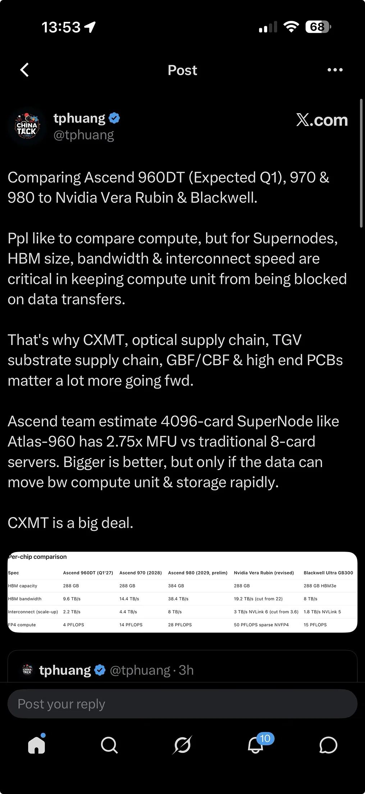
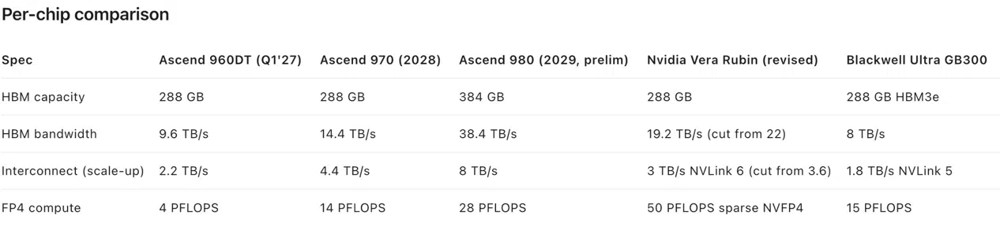

# Ascend 960DT–980 against Vera Rubin: bandwidth and packaging over FLOPS

> Source: [shared conversation](https://chat.deepseek.com/share/wyp1e6d4rq6hhyvbc8) on chat.deepseek.com — one question, with two screenshots of a post by [@tphuang](https://x.com/tphuang) comparing Huawei's Ascend roadmap with Nvidia's current parts. The source link expires when the conversation is deleted from DeepSeek.

The post compares Huawei's announced and projected Ascend accelerators with Nvidia's Vera Rubin and Blackwell Ultra, and argues that compute has become the least informative column in such a comparison. In a SuperNode, the claim goes, HBM capacity, HBM bandwidth, and scale-up interconnect decide whether the compute units stay fed; a node whose arithmetic outruns its data movement spends its time waiting.

## The comparison

| Spec | Ascend 960DT (Q1 2027) | Ascend 970 (2028) | Ascend 980 (2029, preliminary) | Vera Rubin (revised) | Blackwell Ultra GB300 |
| --- | --- | --- | --- | --- | --- |
| HBM capacity | 288 GB | 288 GB | 384 GB | 288 GB | 288 GB HBM3e |
| HBM bandwidth | 9.6 TB/s | 14.4 TB/s | 38.4 TB/s | 19.2 TB/s (cut from 22) | 8 TB/s |
| Interconnect (scale-up) | 2.2 TB/s | 4.4 TB/s | 8 TB/s | 3 TB/s NVLink 6 (cut from 3.6) | 1.8 TB/s NVLink 5 |
| FP4 compute | 4 PFLOPS | 14 PFLOPS | 28 PFLOPS | 50 PFLOPS sparse NVFP4 | 15 PFLOPS |

The pattern is that Huawei's roadmap closes the bandwidth and interconnect gap first and the arithmetic gap last: by 2028 the projected Ascend 970 exceeds the revised Vera Rubin figure for HBM bandwidth and interconnect while remaining well below it on FP4 throughput. The 2029 column is marked preliminary.

## The argument

- A 4,096-card SuperNode of the Atlas-960 class is estimated by the Ascend team at **2.75× the model FLOPs utilisation (MFU)** of conventional eight-card servers. Scale helps, but only if data can move as fast as the compute and storage around it.
- The consequence is a shift in what matters competitively: **CXMT** (domestic HBM supply), the optical interconnect supply chain, **TGV** glass substrates, **GBF/CBF** glass or carrier baseboards, and high-end PCBs.
- The post's summary judgement is that CXMT is the significant item, since memory supply is the part of the stack that sanctions target most directly.

## The acronyms

- **HBM** — high-bandwidth memory stacked beside the processor; *HBM3e* is a newer generation.
- **TB/s** — terabytes per second, the rate at which the accelerator reads and writes memory.
- **CXMT** — ChangXin Memory Technologies, the Chinese memory manufacturer.
- **FP4 / NVFP4** — four-bit floating point, a low-precision format used mainly for inference; NVFP4 is Nvidia's variant.
- **PFLOPS** — petaflops, one quadrillion operations per second.
- **MFU** — model FLOPs utilisation: the share of peak arithmetic throughput a real workload actually reaches.
- **NVLink 5 / 6** — Nvidia's proprietary GPU-to-GPU links.
- **SuperNode / Atlas-960** — a large cluster wired to behave as one machine; 4,096 cards in this case.
- **TGV** — through-glass via, a packaging technique that drills connections through glass rather than silicon or organic substrate.
- **GBF / CBF** — glass baseboard and carrier baseboard, the substrate the package sits on.
- **DT** — the data-centre variant suffix on the Ascend part.

## Why it matters

The comparison relocates the contest from arithmetic to memory supply and advanced packaging, where the binding constraint is not design but fabrication and materials. Two cautions belong with it: the 970 and 980 figures are projections on a roadmap, not shipping hardware, and the revised Vera Rubin numbers show Nvidia adjusting its own specifications downward, so the table measures intent at a point in time rather than delivered performance.

## Source screenshots

