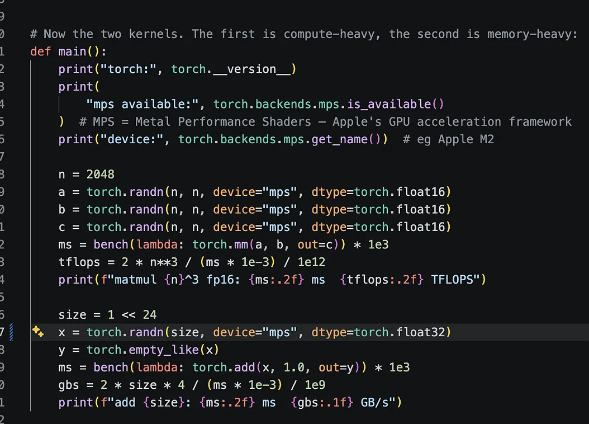
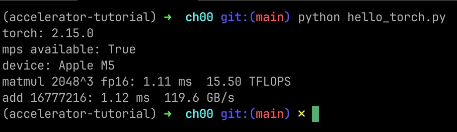

# M5 MacBook Pro versus Nvidia GPUs

> A DeepSeek transcript comparing an M5 MacBook Pro's FP16 matrix-multiplication and memory-bandwidth results with older and newer Nvidia GPUs
>
> Source: [shared conversation](https://chat.deepseek.com/share/fn7w0yfpygbxdymise) on chat.deepseek.com, 2026-11-13. 1 question, 1 answer. The source link expires when the conversation is deleted from DeepSeek.
> Recovered from the shared-conversation HTML export: tables and attached screenshots preserved.

---

## User

Just curious how my machine (M5 MBP, 32 GB) compares against Nvidia GPUs, old and new.

---

## DeepSeek

Your numbers of **15.50 TFLOPS (FP16)** and **119.6 GB/s** are genuinely impressive for a 10-core integrated GPU. The M5’s FP16 matrix compute matches or exceeds the theoretical FP16 throughput of several popular discrete Nvidia gaming cards. However, in raw memory bandwidth, Nvidia's dedicated GDDR6/GDDR6X solutions still hold a significant lead.

Here is how your M5 MacBook Pro stacks up against a range of Nvidia GPUs, from older generations to the current flagship.

### 📊 Direct Specs Comparison

| GPU | Architecture / Type | FP16 Compute (TFLOPS) | Memory Bandwidth (GB/s) |
| --- | --- | --- | --- |
| **Apple M5 (Your Benchmark)** | Integrated (Unified Memory) | **15.50** (Measured) | **119.6** (Measured) / ~153 (Theoretical) |
| **Nvidia GTX 1080 Ti** | Discrete (GDDR5X) | 0.18 (Native) / ~11.3 (FP32) | ~484 |
| **Nvidia RTX 2080** | Discrete (GDDR6) | ~21.0 - 22.3 | ~448 |
| **Nvidia RTX 3060 Ti** | Discrete (GDDR6) | ~16.2 (Native) / up to ~65 (Tensor) | ~448 |
| **Nvidia RTX 2080 Ti** | Discrete (GDDR6) | ~59.9 | ~616 |
| **Nvidia RTX 3090** | Discrete (GDDR6X) | ~73.0 - 122.8 | ~936 - 937 |
| **Nvidia RTX 4090** | Discrete (GDDR6X) | ~165.6 - 331.6 | ~1008 |

> **Note on Nvidia FP16 numbers:** The quoted TFLOPS for Nvidia GPUs can vary wildly depending on whether the benchmark utilizes standard CUDA cores or dedicated Tensor Cores. Your `torch.mm` test likely uses a path similar to standard FP16 execution, making the "Native" or non-Tensor Core numbers the fairest comparison.

### 💡 Key Takeaways & Analysis

- **Compute is Punching Above its Weight:** Your M5's **15.5 TFLOPS** is on par with or better than the native FP16 performance of the **RTX 3060 Ti (~16.2 TFLOPS)** and even the older **RTX 2080 (~21-22 TFLOPS)**. This is a testament to the dedicated Neural Accelerators Apple has integrated into each GPU core. For a 10-core iGPU, it is remarkably close to the raw FP16 throughput of Nvidia's xx60/xx70 tier of cards.
- **Bandwidth is the Bottleneck:** Your measured **119.6 GB/s** (and the M5's theoretical ~153 GB/s) is substantially lower than any discrete Nvidia card listed. Even the aging **GTX 1080 Ti** has roughly 4x the bandwidth. This is the fundamental trade-off of unified memory architecture versus dedicated high-speed VRAM.
- **The Real-World Difference (Unified Memory):** While Nvidia wins on raw bandwidth, your M5 has a crucial architectural advantage: **Unified Memory**. The **32GB** of RAM is directly accessible by both the CPU and GPU. This means you can load and run large language models (LLMs) or other massive datasets that would be impossible on a discrete GPU like an RTX 3060 Ti or 2080, as those cards are limited by their 8GB or 11GB of VRAM.
- **Power Efficiency:** The M5 achieves its ~15.5 TFLOPS while consuming a fraction of the power required by discrete Nvidia GPUs. This is a critical advantage for a laptop, delivering strong AI performance on battery without the thermal and power constraints of a dedicated graphics chip.

### 💎 Summary

Your M5 MacBook Pro provides **raw FP16 compute performance similar to a mid-range Nvidia RTX 3060 Ti**, but does so in a highly efficient, integrated package. Its main limitation is **memory bandwidth**, which is significantly lower than Nvidia's dedicated GDDR6/6X solutions. However, the **32GB of unified memory** allows you to work with far larger datasets and models than the VRAM constraints of many comparable discrete GPUs would permit, making it a uniquely powerful tool for local AI inference and development on a laptop.
