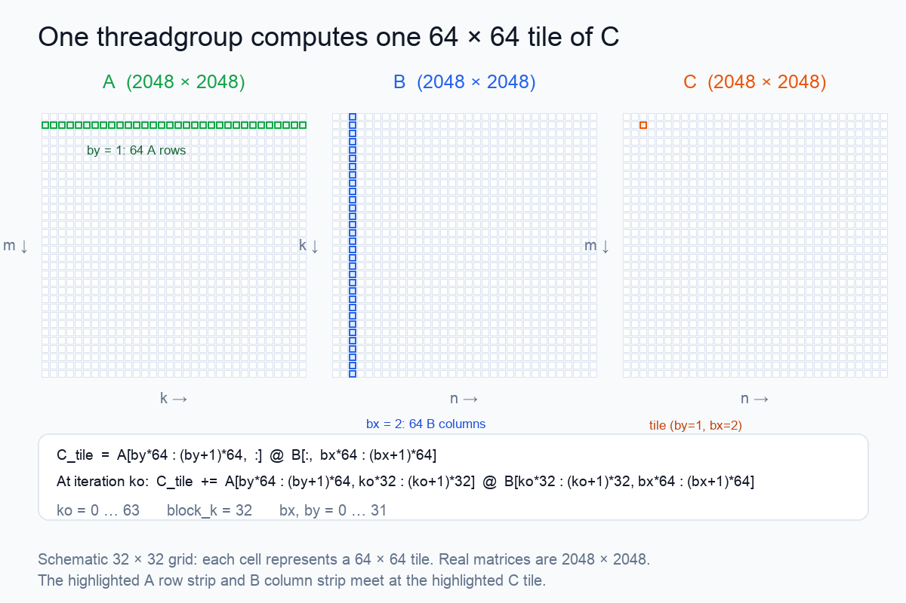
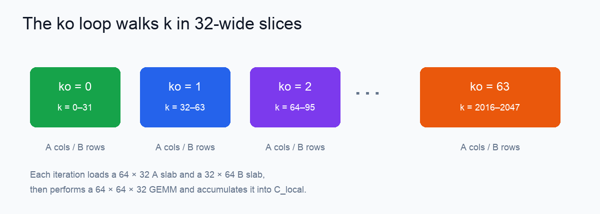
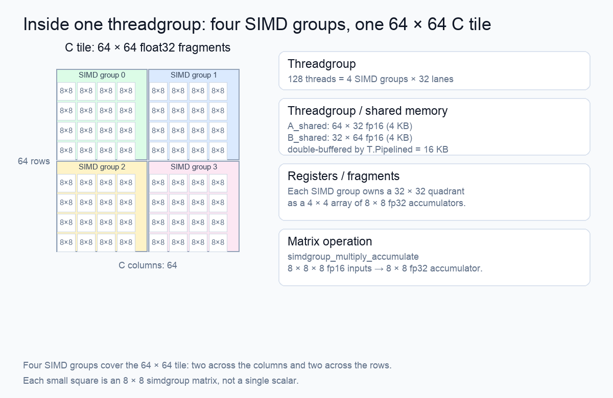

# How TileLang's hello GEMM maps onto the M5 GPU

> Based on `/Users/dlcmh/dev/accelerator-tutorial/labs/ch00/hello_tilelang.py`, run on an M5 MacBook Pro with 32 GB of unified memory on 2026-11-14.

This article follows one TileLang matrix-multiplication kernel from the Python source to the Metal code it generates. The goal is to explain what each variable means, which part of the matrices a threadgroup is computing, where the data lives on the M5, and what happens on each iteration of the reduction loop.

The only mathematical prerequisite is the dot product: multiplying a row of `A` by a column of `B` and summing the products.

## What the program computes

The program multiplies two `2048 × 2048` matrices:

```text
A: 2048 × 2048, float16
B: 2048 × 2048, float16
C: 2048 × 2048, float32
```

Each element of `C` is one dot product:

```text
C[i,j] = sum over q of A[i,q] * B[q,j]
```

The kernel does not compute one dot product at a time. It computes a rectangular tile of `C` in each threadgroup, and it divides the long dot product over `q` into smaller `k` slices.

## The launch grid: `bx` and `by`

The kernel launch is:

```cpp
with T.Kernel(
    T.ceildiv(n, block_n),
    T.ceildiv(m, block_m),
    threads=threads
) as (bx, by):
```

With `m = n = 2048`, `block_m = block_n = 64`, and `threads = 128`:

```text
grid x = ceil(2048 / 64) = 32
grid y = ceil(2048 / 64) = 32
threadgroups = 32 × 32 = 1024
threads per threadgroup = 128
```

`bx` is the block index in the x direction. `by` is the block index in the y direction.



*The highlighted A row strip and B column strip meet at the highlighted C tile. `ko` walks the shared k dimension in 32-wide slices.*

The x direction corresponds to columns of `B` and `C`. The y direction corresponds to rows of `A` and `C`. Therefore:

```text
bx selects a 64-column block of C and B
by selects a 64-row block of C and A
```

For `by = 1` and `bx = 2`, the threadgroup owns:

```text
C[64:128, 128:192]
```

It needs all 2048 columns of the corresponding A rows and all 2048 rows of the corresponding B columns. It does not load those entire strips at once. It walks them in `k` slices.

`bx` and `by` are grid coordinates, not matrix coordinates. The names follow the usual `blockIdx.x` and `blockIdx.y` convention: `b` for block, `x` and `y` for the two grid axes. They are not thread indices, and they are not `i` and `j` positions inside a matrix.

## One tile: 64 × 64 outputs

Inside the threadgroup:

```cpp
A_shared = T.alloc_shared((block_m, block_k), in_dtype);
B_shared = T.alloc_shared((block_k, block_n), in_dtype);
C_local = T.alloc_fragment((block_m, block_n), "float32");
```

The three buffers have different jobs:

| Buffer | Shape | Contents | Hardware location |
| --- | --- | --- | --- |
| `A_shared` | 64 × 32 fp16 | One A tile for the current `ko` | Threadgroup/shared memory |
| `B_shared` | 32 × 64 fp16 | One B tile for the current `ko` | Threadgroup/shared memory |
| `C_local` | 64 × 64 fp32 | Output tile accumulator | Registers, as SIMD-group fragments |

`A_shared` holds 2048 fp16 values, or 4096 bytes. `B_shared` holds 2048 fp16 values, also 4096 bytes. With two pipeline stages, the threadgroup allocates 16,384 bytes of shared memory:

```text
2 stages × (4096 + 4096) bytes = 16,384 bytes
```

`C_local` is logically 4096 fp32 values, or 16,384 bytes. It is not stored as one ordinary array per thread; it is distributed across the 128 threads and represented by SIMD-group matrix fragments. Each thread is responsible for 32 of the 4096 output values on average.

## The `ko` loop

The reduction over `k` is split into:

```cpp
for ko in T.Pipelined(T.ceildiv(k, block_k), num_stages=2):
```

With `k = 2048` and `block_k = 32`:

```text
number of k tiles = ceil(2048 / 32) = 64
ko = 0, 1, 2, ..., 63
```

At iteration `ko`:

```text
A tile: A[by*64 : (by+1)*64, ko*32 : (ko+1)*32]
B tile: B[ko*32 : (ko+1)*32, bx*64 : (bx+1)*64]
```

The operation is:

```text
C_local += A_tile @ B_tile
```

That is a `64 × 64 × 32` matrix multiply. It performs:

```text
64 × 64 × 32 = 131,072 multiply-accumulate operations
```

into the same `C_local` fragment. Nothing is written to global `C` until all 64 k slices have been accumulated.



*Each `ko` iteration advances the k window by 32. A and B contribute a new 32-wide slice to the same 64 × 64 accumulator.*

The source-level loop order is:

1. Copy the A and B tile for `ko` into shared memory.
2. Multiply the two shared tiles and accumulate into `C_local`.
3. Advance to the next `ko`.

`T.Pipelined(..., num_stages=2)` changes the execution schedule. The generated Metal source uses two shared-memory buffers and overlaps the load of the next k tile with the matrix computation of the current tile. The source still expresses 64 logical iterations; the compiler emits a prologue, a steady-state loop, and an epilogue.

Before the loop, `T.clear(C_local)` sets every output accumulator to zero. After all 64 k slices have been processed, `T.copy(C_local, C[by * block_m, bx * block_n])` writes the finished 64 × 64 tile to global memory.

`ko` is named as the **k-offset** or **k-outer** loop variable. `k` is the contraction dimension; the `o` distinguishes the outer tile loop from the inner offset within a tile. The exact letter is a naming convention, not a TileLang keyword.

## What happens inside one iteration

The generated Metal source shows the concrete sequence for each `ko`:

1. **Load A and B into shared memory.** Threads copy global `A` and `B` data into `A_shared` and `B_shared`. The generated code uses `uint4` loads: each 16-byte load carries eight fp16 values, and the 128 threads cooperatively fill the two 2048-element tiles.
2. **Barrier.** The threadgroup waits until every thread has finished writing the shared tiles.
3. **Load fragments.** Each SIMD group loads `8 × 8` fp16 fragments from shared memory into registers.
4. **Matrix multiply-accumulate.** The hardware performs `simdgroup_multiply_accumulate` on `8 × 8` A and B fragments and adds the result into an `8 × 8` fp32 accumulator.
5. **Repeat the fragments.** For each `ko`, the kernel repeats the fragment loads and multiply-accumulates for the four 8-wide slices that make up `block_k = 32`.
6. **Next iteration.** The next `ko` loads a new 32-wide slice of A and B and accumulates into the same `C_local`.

The inner `ki` loop in the generated source has four steps because:

```text
block_k / 8 = 32 / 8 = 4
```

Each `ki` step handles eight values of the dot product, which is the native width of the SIMD-group matrix operation.

## Mapping the threadgroup onto the M5 GPU

The threadgroup contains 128 threads. On the M5 GPU, Metal exposes a SIMD-group width of 32, so:

```text
128 threads / 32 threads per SIMD group = 4 SIMD groups
```

Each SIMD group computes one quadrant of the 64 × 64 output tile:

```text
2 × 2 grid of quadrants
each quadrant: 32 × 32 outputs
each quadrant: 4 × 4 array of 8 × 8 fragments
```



*The 64 × 64 C tile is split into four 32 × 32 quadrants. Each SIMD group owns one quadrant and computes it as sixteen 8 × 8 matrix fragments.*

The generated Metal source confirms this arrangement:

- `threadgroup uchar buf_dyn_shmem[16384]` is the shared-memory allocation.
- `simdgroup_float8x8 C_local[64]` represents the accumulator fragments.
- `simdgroup_half8x8 A_local[4]` and `B_local[4]` are the per-slice input fragments.
- `simdgroup_multiply_accumulate` is the matrix operation.
- `__simd_group_id` selects which of the four SIMD groups is executing.

### Threads, lanes, SIMD groups, and threadgroups

These terms describe different levels of the same execution hierarchy:

| Term | Size in this kernel | Meaning |
| --- | --- | --- |
| Thread | 1 | One execution context with its own registers. A lane is one thread considered by its position inside a SIMD group. |
| SIMD group | 32 threads | A group of threads that executes matrix operations cooperatively. Metal calls this a SIMD group; other systems call it a warp or a wavefront. |
| Threadgroup | 128 threads = 4 SIMD groups | A Metal scheduling and cooperation unit. Its threads share threadgroup memory and synchronization barriers. |
| GPU core | Hardware | Executes one or more threadgroups, subject to resource limits. It is not a software type in the TileLang program. |

In `T.Kernel(..., threads=128)`, the number is the number of threads in each threadgroup, not the total number of threads in the launch.

One threadgroup is **not** one SIMD group. In this kernel, one threadgroup contains four SIMD groups:

```text
128 threads / 32 threads per SIMD group = 4 SIMD groups
```

One lane is one thread. “Lane” is the name for a thread's position within its SIMD group. The 32 lanes of a SIMD group execute the same matrix instruction cooperatively; a single lane does not hold a complete 8 × 8 matrix.

The launch contains:

```text
1024 threadgroups × 128 threads = 131,072 threads
1024 threadgroups × 4 SIMD groups = 4096 SIMD groups
```

Each threadgroup owns 4096 output values, so each of its 128 threads is responsible for 32 values on average. An 8 × 8 fragment contains 64 values distributed across 32 lanes, or two values per lane.

A useful hardware map is:

| TileLang object | M5 / Metal meaning |
| --- | --- |
| `A`, `B`, `C` tensors | Device/global memory, backed by unified memory on the M5 |
| `T.Kernel` grid | A 32 × 32 grid of threadgroups |
| `threads=128` | Four SIMD groups of 32 lanes |
| `A_shared`, `B_shared` | Threadgroup/shared memory, 16 KB with double buffering |
| `C_local` | fp32 accumulator fragments in registers |
| `T.gemm` | `simdgroup_multiply_accumulate` on 8 × 8 fragments |
| `T.copy` | Vectorized global-to-shared or fragment-to-global transfers |

A threadgroup is not the same as a GPU core. The GPU scheduler places the 1024 threadgroups on its available cores, subject to shared-memory and register limits. Multiple threadgroups may occupy a core when resources allow.

## Why the fragment shapes are 8 × 8

The generated code uses `simdgroup_float8x8`, `simdgroup_half8x8`, and `simdgroup_multiply_accumulate`. These are Metal's matrix-fragment operations. One accumulate instruction combines:

```text
8 × 8 fp16 A fragment
8 × 8 fp16 B fragment
8 × 8 fp32 C fragment
```

which performs:

```text
8 × 8 × 8 = 512 multiply-accumulate operations
```

Each SIMD group covers 32 × 32 outputs. That requires:

```text
(32 / 8) × (32 / 8) = 4 × 4 = 16 fragments per SIMD group
```

and each `ko` has four 8-wide k slices:

```text
4 × 16 = 64 fragment multiply-accumulate instructions per SIMD group per ko
```

Across four SIMD groups, one `ko` performs:

```text
4 × 64 × 512 = 131,072 MACs
```

which matches the `64 × 64 × 32` tile product.

## The arithmetic for the whole launch

One threadgroup computes a 64 × 64 output tile over the full k dimension:

```text
64 × 64 × 2048 = 8,388,608 MACs per threadgroup
```

There are 1024 threadgroups:

```text
1024 × 8,388,608 = 8,589,934,592 MACs
```

A multiply-accumulate counts as two floating-point operations:

```text
2 × 8,589,934,592 = 17,179,869,184 FLOPs
```

That is approximately 17.18 GFLOP.

## The measured result

The lab was run on the M5 MacBook Pro with the repository's Python 3.12 environment:

```text
$ .venv/bin/python labs/ch00/hello_tilelang.py
tilelang 2048^3 fp16->fp32: 5.11 ms  3.36 TFLOPS  ok=True
generated source lines: 152
simd references: 92
```

The correctness check passed: `ok=True`. The kernel generated 152 lines of Metal source containing 92 references to SIMD-group operations.

The same machine ran the PyTorch MPS baseline in `hello_torch.py`:

```text
torch: 2.15.0
mps available: True
device: Apple M5
matmul 2048^3 fp16: 1.32 ms  13.05 TFLOPS
```

The TileLang kernel is about 3.9 times slower than this particular PyTorch baseline. That is not a statement about the M5's peak capability. This is a first tiling kernel, and it leaves substantial performance on the table. Block size, register pressure, shared-memory layout, pipeline depth, occupancy, and Metal code generation all affect the result. The lab's purpose is to make the mapping visible and correct before optimizing it.

## Why the code uses these block sizes

The values are not arbitrary:

- `block_m = 64`, `block_n = 64` give a 64 × 64 output tile.
- `block_k = 32` gives a 32-wide slice of the reduction dimension.
- The shared-memory footprint is `(64×32 + 32×64) × 2 bytes = 8 KB` per stage.
- Two stages require 16 KB.
- The accumulator tile is `64×64×4 bytes = 16 KB` of logical fragment storage.
- `threads = 128` gives four SIMD groups, enough to cover a 2 × 2 arrangement of 32 × 32 quadrants.

These choices balance work per threadgroup against shared-memory and register use. Larger tiles increase reuse but require more shared memory and registers; smaller tiles increase scheduling flexibility but reduce reuse.

## Summary

- `bx` and `by` are x/y grid coordinates. `bx` selects the output column tile; `by` selects the output row tile.
- `ko` is the k-offset/k-outer loop index. It walks the contraction dimension in 32-wide slices.
- One threadgroup computes one 64 × 64 tile of `C`, accumulating over 64 k slices.
- `A_shared` and `B_shared` hold the current 64 × 32 and 32 × 64 input tiles; `C_local` holds the output accumulator.
- On the M5, one threadgroup is 4 SIMD groups. Each SIMD group computes a 32 × 32 quadrant with 8 × 8 matrix fragments.
- The lab is correct and completes in 5.11 ms at 3.36 TFLOPS on this machine. It is a starting point for understanding and optimizing a tiled GEMM, not a peak-performance implementation.
