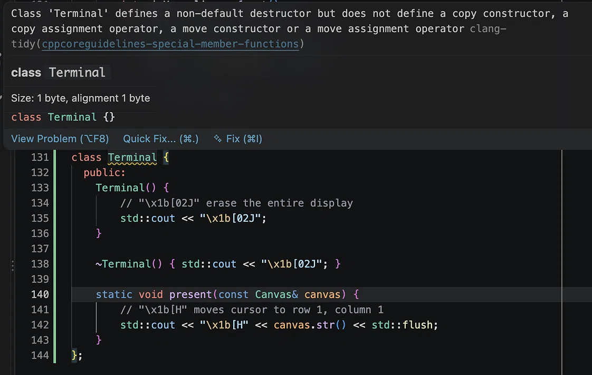

# What `\x1b[2J` does in a C++ terminal program

```cpp
std::cout << "\x1b[02J";
```

This writes an ANSI escape sequence that asks the terminal to erase the display. The leading zero in `02` is harmless; the parameter is parsed as `2`.

## The sequence

| Part | Meaning |
| --- | --- |
| `\x1b` | Escape character, hexadecimal `0x1B` (27). Octal `\033` is equivalent. |
| `[` | Control Sequence Introducer (CSI), marking the start of a control sequence. |
| `02` | Parameter `2`: erase the entire display. |
| `J` | Erase in Display (ED) command. |

`\x1b[02J` and `\x1b[2J` are the same command.

## The parameter

`J` takes an optional parameter:

- `0J` or `J`: erase from the cursor to the end of the display.
- `1J`: erase from the start of the display to the cursor.
- `2J`: erase the entire display.
- `3J`: erase the saved lines/scrollback. This is an xterm extension, not part of the original ANSI command set, and is not universally supported.

## It does not move the cursor

`CSI 2 J` clears the display but does not move the cursor to the home position. In a typical terminal, the cursor stays where it was. A program that needs both operations must issue a cursor-position command as well:

```cpp
std::cout << "\x1b[2J"  // clear the display
          << "\x1b[H"   // move the cursor to row 1, column 1
          << std::flush;
```

`CSI H` without parameters is the home-position command. `CSI row;column H` moves to a specific position.

The order can be reversed (`\x1b[H\x1b[2J`) if the intent is to home first and then clear. The two sequences do different jobs.

## Buffering

`std::cout` is buffered. If the clear must be visible immediately, flush after writing the sequence:

```cpp
std::cout << "\x1b[2J\x1b[H" << std::flush;
```

Without a flush, the bytes may remain in the stream buffer until a later output operation or program exit.

## A small RAII terminal wrapper

A class can package the terminal setup and cleanup:

```cpp
#include <iostream>

class Terminal {
public:
    Terminal() {
        std::cout << "\x1b[2J" << std::flush;
    }

    Terminal(const Terminal&) = delete;
    Terminal& operator=(const Terminal&) = delete;
    Terminal(Terminal&&) = delete;
    Terminal& operator=(Terminal&&) = delete;

    ~Terminal() {
        std::cout << "\x1b[0m\n" << std::flush;
    }

    void present(const Canvas& canvas) {
        std::cout << "\x1b[H" << canvas.str() << std::flush;
    }
};
```

`present` assumes the `Canvas` type from the [character-mode alien-fleet tutorial](macos-character-mode-alien-fleet.md), specifically a `str()` method that returns the full frame.

The `~Terminal` function is the destructor. It runs automatically when the `Terminal` object leaves its scope. The constructor clears the screen once; the destructor resets text attributes with `\x1b[0m` and writes a newline so the shell prompt starts on a fresh line. The class is non-copyable so two objects cannot both perform terminal cleanup.

The destructor is the reason to use RAII here. The terminal is not put into raw mode or switched to an alternate screen, but it does receive a clear and an attribute reset. If those operations were left in `main`, every early return would need to repeat them.

### Why the copy operations are deleted

```cpp
Terminal(const Terminal&) = delete;
Terminal& operator=(const Terminal&) = delete;
```

The first line deletes the copy constructor. The second deletes the copy-assignment operator. `= delete` makes each function unavailable: any attempt to copy a `Terminal` or assign one `Terminal` to another is a compile-time error.

A `Terminal` is a resource guard. Its destructor resets terminal state, so there must be one live object responsible for that cleanup. If the object were copied, both copies would run their destructors. Cleanup could happen twice, or one copy could reset the terminal while another copy was still using it. If the guard were extended to own raw mode or an alternate screen, restoring twice or at the wrong time would be a correctness problem. Deleting the copy operations enforces a single owner.

Deleting the copy operations alone also suppresses implicit move operations, so the type becomes neither copyable nor movable. That suppression is implicit and easy to overlook. Making it explicit accounts for all five special member functions and satisfies the clang-tidy check.

### The Rule of Five and the special-member warning



*The screenshot shows the diagnostic in an earlier version of the class, where the destructor clears the display. The warning concerns the declared special members, not the escape sequence.*

The warning is `cppcoreguidelines-special-member-functions`, from a [DeepSeek discussion of this class](https://chat.deepseek.com/share/dmxllvvwio6dd2pgmz). A class that declares a non-default destructor but does not declare the copy and move operations receives it, because the C++ Core Guidelines' [Rule of Five (C.21)](https://isocpp.github.io/CppCoreGuidelines/CppCoreGuidelines#c21-if-you-define-or-delete-any-copy-move-or-destructor-function-define-or-delete-them-all) expects the set of special members to be considered together:

- destructor;
- copy constructor;
- copy-assignment operator;
- move constructor;
- move-assignment operator.

The complete non-copyable and non-movable form is:

```cpp
Terminal(const Terminal&) = delete;
Terminal& operator=(const Terminal&) = delete;
Terminal(Terminal&&) = delete;
Terminal& operator=(Terminal&&) = delete;

~Terminal() { /* restore terminal state */ }
```

`= default` on the copy and move operations would be appropriate only if copying or moving a `Terminal` were semantically valid. For this guard it is not: a copy would duplicate the cleanup responsibility. Deletion is the correct declaration for all four.

The move operations need not appear as separate deleted declarations for the class to *behave* as non-movable; the language suppresses them when copying is deleted. The explicit declarations exist to document the design and to satisfy the Rule of Five check.

### Is the tilde required in every class?

No. The tilde is only the syntax for declaring a destructor. If a class does not declare one, the compiler generates an implicit destructor that destroys its members.

Most classes should follow the Rule of Zero: store resources in members that manage themselves, such as `std::string` and `std::vector`, and do not declare a destructor. A user-declared destructor is needed when the class directly owns a resource that must be released or a state that must be restored:

- allocated memory;
- a file or socket;
- a lock;
- a terminal mode, alternate screen, hidden cursor, or text attributes.

`Canvas` does not need a custom destructor because `std::vector` releases its storage. `Terminal` needs one because it changes terminal state.

A destructor is not a guaranteed cleanup hook for every exit. It runs when an object leaves scope or is deleted. It does not run for automatic objects during `std::exit`, and it does not run on `std::abort` or an unhandled signal. If a program puts the terminal into raw mode or an alternate screen, cleanup should also be reachable from an explicit shutdown path or a signal handler. This wrapper only resets text attributes, so missing that path leaves at most a cosmetic change.

## Portability

ANSI/VT sequences are widely supported by macOS Terminal, iTerm2, and Linux terminals. They are not guaranteed in every output context: IDE run windows, log files, and non-terminal streams may display the bytes literally or ignore them.

For a program that must work across terminal types, use a terminal library or the `curses`/`ncurses` API rather than hard-coded escape sequences. For a small macOS terminal experiment, the direct sequence is sufficient.

## Summary

`\x1b[2J` erases the entire display. It does not home the cursor. Use a second sequence such as `\x1b[H` for that, and flush the stream if the result must appear immediately.
