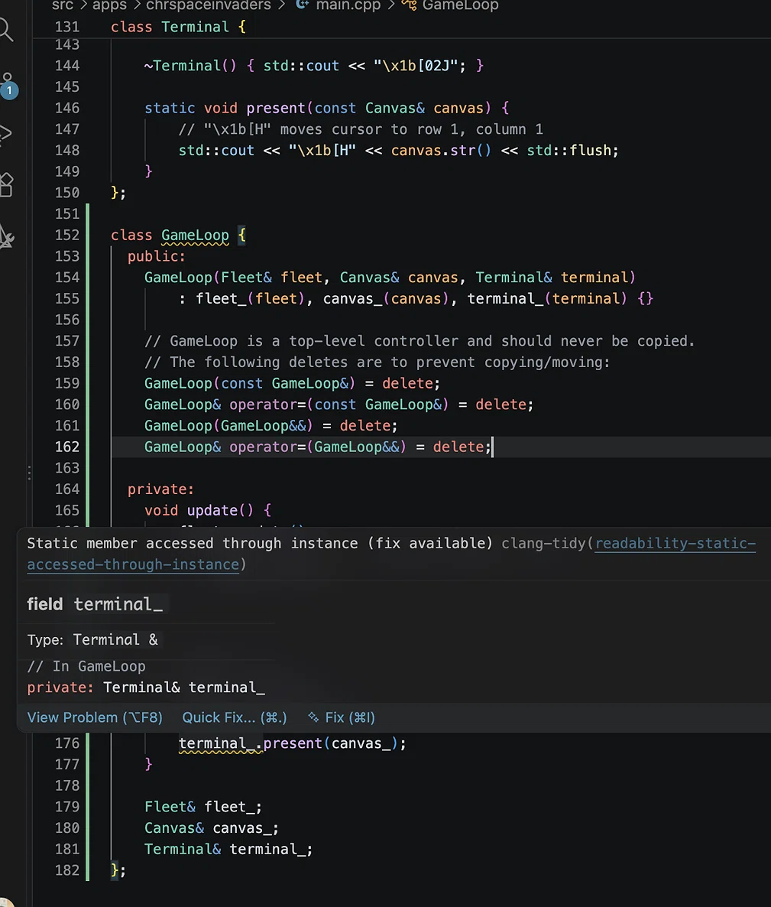

# Calling a static member through an instance

> A DeepSeek conversation on clang-tidy's readability-static-accessed-through-instance warning and the correct `Terminal::present(canvas_)` call.
>
> Source: [shared conversation](https://chat.deepseek.com/share/v7w6ujzgkqeg352tta) on chat.deepseek.com. 1 question, 1 answer. The source link expires when the conversation is deleted from DeepSeek.
>
> Recovered from the shared-conversation HTML export: web citations and the attached screenshot preserved.

---

## User



*The screenshot that prompted the conversation: clang-tidy's `readability-static-accessed-through-instance` warning on `terminal_.present(canvas_)`.*

---

## DeepSeek

The warning occurs because `present()` is a `static` member function of `Terminal`, but your code is calling it through an instance reference (`terminal_`). In C++, static methods belong to the class itself, not to any individual object.

To fix this, you should call the function using the class name with the scope resolution operator `::`:[[1]](https://clang.llvm.org/extra/clang-tidy/checks/readability/static-accessed-through-instance.html)

```cpp
// Replace terminal_.present(canvas_); with:
Terminal::present(canvas_);
```

### Why this happens

The `readability-static-accessed-through-instance` check identifies code that uses an object instance to access a static member. Since `present` is defined as `static` (line 146), it does not rely on a specific `Terminal` instance (the `this` pointer is not needed). Calling it via the class name clarifies your intent and makes it clear that no object state is being used.[[2]](https://clang.llvm.org/extra/doxygen/classclang_1_1tidy_1_1readability_1_1StaticAccessedThroughInstanceCheck.html)[[4]](https://searchfox.org/llvm/rev/ee57a685fae2f8feb81015b89f784a44e1b2bfa7/clang-tools-extra/docs/clang-tidy/checks/readability/static-accessed-through-instance.rst)

### How to apply the fix

You can make this change manually, or use the IDE's quick fix (you can see the `Quick Fix...` option in your screenshot).

- **Note on `terminal_`**: Since the `GameLoop` constructor requires a `Terminal& terminal` reference, the `terminal_` field itself is still valid and must be kept. The only change is in how you invoke the `present` method.
