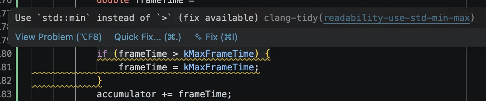

# Clamping frame time with std::min

> Based on a DeepSeek conversation about clang-tidy's `readability-use-std-min-max` warning: [shared conversation](https://chat.deepseek.com/share/socsqrzo7aiw65dckh).



*The warning points at a manual upper-bound clamp in the frame-time code.*

The original code limits a frame time to a maximum:

```cpp
if (frameTime > kMaxFrameTime) {
    frameTime = kMaxFrameTime;
}
```

clang-tidy's `readability-use-std-min-max` check reports this pattern and recommends `std::min`.

## The fix

Include `<algorithm>` and replace the block with one assignment:

```cpp
#include <algorithm>

frameTime = std::min(frameTime, kMaxFrameTime);
```

`std::min(a, b)` returns the smaller of its two arguments. If `frameTime` is already at or below the maximum, the result is `frameTime`; otherwise the result is `kMaxFrameTime`. The behavior is the same as the `if` statement for ordinary numeric values.

## Why it is clearer

The assignment states the intent directly: clamp the value to the smaller of the current frame time and the maximum. The branch and the repeated assignment disappear, and the reader does not need to verify that the condition and the assignment use the same limit.

The two arguments should have the same type. If `frameTime` is a `double`, `kMaxFrameTime` should also be a `double` or a value that converts cleanly. Mixed types can make template deduction fail.

## Performance

There is no meaningful performance penalty in this use case.

- `std::min` is a small inline template. It performs no allocation and no virtual dispatch.
- For a `double`, the compiler typically emits a compare and a conditional move, or a dedicated minimum instruction. A release build can produce the same code as the `if`.
- The standard signature takes arguments by `const` reference, but for scalar types the compiler normally removes the references during optimization.
- The clamp runs once per frame, not once per pixel or entity. Even an unoptimized call would be negligible at that frequency.

A branching `if` can be preferable when the condition is almost always true or false and the compiler chooses a predictable branch. `std::min` may instead produce a branchless conditional move. Neither difference is significant for a per-frame clamp, and neither justifies retaining the manual form without measurement.

The check is a readability transformation, not an optimization. It should not make a measured hot loop slower; if a benchmark ever shows otherwise, the benchmark should decide.

## When std::min is not enough

`std::min` applies only an upper bound. If the value also needs a lower bound, use `std::clamp`:

```cpp
frameTime = std::clamp(frameTime, 0.0, kMaxFrameTime);
```

`std::clamp` requires C++17 and the lower bound must not exceed the upper bound.

## Summary

Replace the manual upper-bound `if` with:

```cpp
frameTime = std::min(frameTime, kMaxFrameTime);
```

The result is the same, the intent is clearer, and the performance difference for a per-frame scalar clamp is negligible. Use `std::clamp` when both bounds are required.

## Reference

- DeepSeek, [shared conversation](https://chat.deepseek.com/share/socsqrzo7aiw65dckh).
