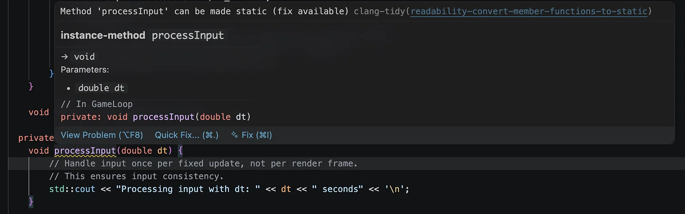

# When clang-tidy says a game-loop method could be static

> Based on a DeepSeek conversation about a clang-tidy warning in a game loop: [shared conversation](https://chat.deepseek.com/share/pvfaui51ogz7ycsyuu). The code under discussion is [`chrspaceinvaders/main.cpp`](https://github.com/dlcmh/cppgamearch/blob/main/src/apps/chrspaceinvaders/main.cpp#L53-L57).
>
> The original message's screenshot of the diagnostic is included below.



*The diagnostic identifies `processInput` as a candidate for conversion to a static member function.*

## The diagnostic

clang-tidy's `readability-convert-member-functions-to-static` check reports a member function that does not access any non-static member of its class. In the game-loop file, `processInput` currently does only this:

```cpp
void processInput(double dt) {
    // Handle input once per fixed update, not per render frame.
    std::cout << "Processing input with dt: " << dt << " seconds" << '\n';
}
```

The function does not read `m_fixedDt`, `m_running`, or any other instance member. The check therefore concludes that it could be a static member function, which would not require a `GameLoop` instance.

The same observation applies to `update` and `render`: at this stage, both only write to `std::cout` and do not touch instance state. A warning on one of those methods represents the same design question.

## Why the warning appears

A non-static member function receives an implicit `this` pointer. If the function never uses that pointer, the parameter is unnecessary. Making the function static removes it and also documents that the function does not depend on a particular object.

The check is mechanically correct. It is not, however, a statement that the function should be static. It identifies a mismatch between the current implementation and the intended interface.

## Why static is usually the wrong fix here

`processInput`, `update`, and `render` are lifecycle hooks. Their purpose is to operate on the game state:

- `processInput` will read keyboard, mouse, or controller state and update player intent.
- `update` will mutate entities, physics, timers, and collision state.
- `render` will read interpolated positions and submit draw calls.

Those operations require instance data. Converting the hooks to static functions now would make the current build pass the linter, but the first real implementation would need to change them back and update their declarations. The warning would return as soon as the method acquired state; the intermediate change adds churn without improving the design.

A static member function can access only static members. It has no `this`, so it cannot touch per-game-loop fields such as `m_running` or a future `m_player`. That restriction is appropriate for pure utility functions, not for the loop's extension points.

## Options

### Implement the state the method needs

The most direct resolution is to make the method use real instance state. If `processInput` begins to read or write an input field, the warning disappears naturally:

```cpp
private:
    bool m_jumpRequested = false;

    void processInput(double dt) {
        // Read input and set m_jumpRequested.
    }
```

The field should represent real behavior, not a dummy value added solely to silence the check.

### Suppress the diagnostic locally

If the method is intentionally an instance method and the implementation is temporarily empty, suppress the specific check at the definition:

```cpp
// NOLINTNEXTLINE(readability-convert-member-functions-to-static)
void processInput(double dt) {
    // ...
}
```

This records the decision at the point of the warning. It is preferable to disabling the check for the whole project, which would hide genuinely static candidates elsewhere.

### Make the function genuinely free

If the function is pure and will remain independent of the loop, move it out of the class:

```cpp
namespace {
void processInput(double dt) {
    // ...
}
}
```

A free function has no implicit `this`, so there is no warning. This is the correct choice only when the function will not need game-loop state.

### Refactor the responsibility

A larger design can move input polling into a separate input system and pass an `InputState` to the loop. That removes the question from `GameLoop` entirely. For the current scaffold, that separation is premature; the loop is still being built one stage at a time.

## Decision

For this learning scaffold, keep the hooks as instance methods. Suppress the specific diagnostic with a comment explaining that the methods will consume instance state once real input, update, and render logic replace the placeholder console output. Revisit the suppression when the methods acquire state; at that point the warning should disappear naturally.

The linter is useful here as a prompt to examine the design, not as an instruction to apply the quick fix. The IDE's automatic fix is appropriate only when the function is genuinely stateless and is expected to remain so.

## Reference

- [`chrspaceinvaders/main.cpp`](https://github.com/dlcmh/cppgamearch/blob/main/src/apps/chrspaceinvaders/main.cpp#L53-L57), especially `processInput` at line 53.
- DeepSeek, [shared conversation](https://chat.deepseek.com/share/pvfaui51ogz7ycsyuu).
