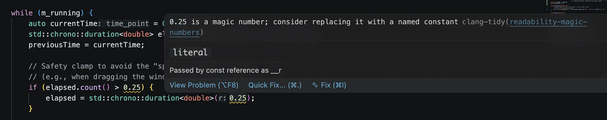

# Naming the spiral-of-death clamp in a game loop

> Based on a DeepSeek conversation about clang-tidy's `readability-magic-numbers` warning in [`chrspaceinvaders/main.cpp`](https://github.com/dlcmh/cppgamearch/blob/main/src/apps/chrspaceinvaders/main.cpp#L23-L24): [shared conversation](https://chat.deepseek.com/share/pam9drh5mgaymof12p).



*clang-tidy's `readability-magic-numbers` warning on both uses of the frame-time clamp.*

The current game loop contains:

```cpp
// Safety clamp to avoid the "spiral of death" after a stall
// (e.g., when dragging the window or a debug break)
if (elapsed.count() > 0.25) {
    elapsed = std::chrono::duration<double>(0.25);
}
```

clang-tidy flags both occurrences of `0.25` as magic numbers. The warning is correct: the value encodes an important policy, but the code does not state what that policy is, and the same literal appears twice.

## What the clamp does

The loop accumulates elapsed time and runs fixed simulation steps until the accumulator is smaller than one step. If a frame stalls for a long time, the accumulator receives a large value. Without a limit, the inner loop attempts to catch up with thousands of simulation steps in one frame, which makes the frame even slower. This is the spiral of death.

The `0.25` clamp limits the elapsed time accepted in one frame to 250 milliseconds. At a 60 Hz simulation rate, that is at most about 15 fixed updates for a single frame. If the application falls below 4 FPS, the simulation advances more slowly than wall-clock time instead of attempting an unbounded catch-up. The clamp trades real-time accuracy for responsiveness.

## Why `0.25` is a magic number

A magic number is a literal whose meaning is not evident from its use. `0.25` could be a target frame duration, a timeout, a scale factor, or a clamp. Only the surrounding comment explains that it is a catch-up limit.

The duplication compounds the problem. If the clamp changes to 100 milliseconds, both literals must change together. A named constant gives the policy one definition and one explanation.

## Fix 1: a named constant

```cpp
class GameLoop {
    // Maximum elapsed time accepted for one frame: 250 ms.
    // Prevents a stall from triggering unbounded catch-up updates.
    static constexpr double MAX_FRAME_TIME_SEC = 0.25;
    // ...
};
```

```cpp
if (elapsed.count() > MAX_FRAME_TIME_SEC) {
    elapsed = std::chrono::duration<double>(MAX_FRAME_TIME_SEC);
}
```

The name states the policy. The comment explains why the value exists. A future adjustment changes one line.

A more precise name would be `MAX_CATCH_UP_SEC` or `MAX_ELAPSED_SEC`, because the value is a ceiling on accepted elapsed time, not a target frame duration. `MAX_FRAME_TIME_SEC` is workable, but it can be confused with the 16.67 ms target of a 60 Hz frame.

## Fix 2: express the value as a chrono duration

The literal can be removed entirely by giving the constant a duration type:

```cpp
#include <chrono>

class GameLoop {
    // Maximum catch-up time per frame: 250 ms.
    static constexpr std::chrono::milliseconds MAX_FRAME_TIME{250};
    // ...
};
```

```cpp
if (elapsed > MAX_FRAME_TIME) {
    elapsed = MAX_FRAME_TIME;
}
```

`elapsed` is a `std::chrono::duration<double>`, so the comparison converts both operands to a common duration type. The assignment converts the 250 ms limit back to seconds. No `.count()` call is needed at the comparison site, and the unit is part of the type.

This form has three advantages:

- The unit is explicit in the declaration.
- There is no floating-point literal to flag.
- The comparison cannot accidentally mix seconds and milliseconds.

The project already requires C++23, so an in-class `static constexpr` duration is straightforward.

## Which fix to use

The chrono form is the stronger choice for this code because the surrounding computation already uses durations. It removes the unit ambiguity as well as the magic number.

The `double` constant is acceptable when the rest of the loop consistently uses seconds and the team prefers plain arithmetic. Either form is better than a local suppression of the warning: the literal has a real name and a real explanation, so naming it costs little.

## Summary

`0.25` is the maximum elapsed time accepted per frame, used to prevent the spiral of death. It is not a target frame time. Give it a name that describes the policy, define it once, and preferably express it as a `std::chrono::milliseconds` constant so the unit is part of the type.

## References

- [`chrspaceinvaders/main.cpp`](https://github.com/dlcmh/cppgamearch/blob/main/src/apps/chrspaceinvaders/main.cpp#L23-L24).
- DeepSeek, [shared conversation](https://chat.deepseek.com/share/pam9drh5mgaymof12p).
