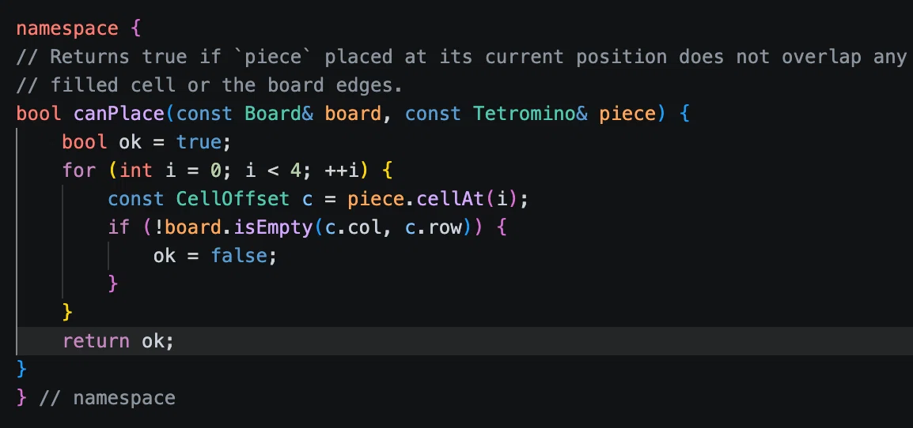

# Will the compiler optimize away a local bool flag?

> Based on a DeepSeek conversation about Clang optimizing an `ok` variable: [shared conversation](https://chat.deepseek.com/share/5lw0wbi674mrl4z4h0).



*A local `ok` flag used to make a validation loop easier to read.*

A local boolean can make a loop clearer:

```cpp
bool canPlace(const Board& board, /* ... */) {
    bool ok = true;

    for (int i = 0; i < count; ++i) {
        if (!board.isFilled(i)) {
            ok = false;
            break;
        }
    }

    return ok;
}
```

The question is whether returning through a named `ok` variable costs anything compared with returning `false` directly inside the loop.

In an optimized build, it usually costs nothing.

## What Clang can do

With optimization enabled, Clang promotes the local variable into a register or a control-flow value. The variable does not need a stack slot. Optimization passes can then recognize that `ok` is set only before the loop exits and is returned immediately.

The generated code can become the equivalent of:

```cpp
for (int i = 0; i < count; ++i) {
    if (!board.isFilled(i)) {
        return false;
    }
}

return true;
```

The exact result depends on the surrounding code, but this pattern is simple enough that modern compilers handle it routinely.

## Why this is possible

Several optimizations work together:

- **Promotion of locals.** A local `bool` is converted from memory into a register or SSA value.
- **Control-flow simplification.** The compiler sees that setting `ok = false` immediately leads to the loop exit and the return.
- **Branch folding.** The condition can be folded into the loop's exit branch, so the program branches directly to the return path.

The compiler is not required to perform these transformations. They are ordinary optimizations that apply when the control flow is simple and visible.

## Do not measure at -O0

A debug build usually keeps the variable and the corresponding stores and loads. That makes the flag look expensive, but it is not representative of an optimized build.

If performance matters, compare the generated assembly at `-O2` or `-O3`, not at `-O0`. Compiler Explorer or a local `-S` build is sufficient.

## Which form should be written?

Both forms are acceptable:

```cpp
if (!board.isFilled(i)) {
    return false;
}
```

and:

```cpp
bool ok = true;
// ...
if (!board.isFilled(i)) {
    ok = false;
    break;
}
return ok;
```

The flag can be useful when the function has several checks or when cleanup is needed before returning. A direct `return false` is shorter when the loop is the only check. The compiler generally removes the difference in optimized code, so readability should decide.

## Caveat

The optimization is likely, not guaranteed. A flag that is modified in several places, captured by a lambda, or used after complex control flow may survive. The way to know is to inspect the optimized assembly or measure the actual program.

## Summary

- A simple local `ok` flag is usually optimized into control flow.
- Clang and GCC can eliminate the variable's storage and branch directly to the return.
- Debug builds are not a useful measure of this optimization.
- Write the clearer form; inspect assembly or benchmark only when performance is in question.
- Do not assume every flag is free; complex control flow can prevent the transformation.

## Reference

- DeepSeek, [shared conversation](https://chat.deepseek.com/share/5lw0wbi674mrl4z4h0).
