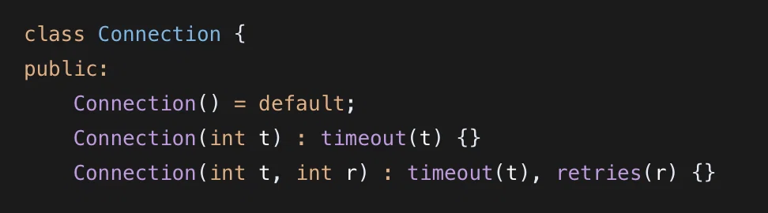

# Default member initializers and constructor overloading in C++

> Based on two DeepSeek conversations: [default member initializers](https://chat.deepseek.com/share/0hgqun2xsfo8cr3gl3) and [constructor overloading](https://chat.deepseek.com/share/ntbwunbc347ulv1uk1).

C++ classes commonly combine two features:

- **default member initializers**, which give members a safe value at the point of declaration;
- **constructor overloading**, which provides several ways to create an object.

Used together, they remove repeated initialization code and make object creation flexible.



*A default constructor and two overloaded constructors for a Connection class.*

## Before C++11

Without default member initializers, every constructor has to initialize every member:

```cpp
class Connection {
public:
    Connection() : timeout(30), retries(3) {}
    Connection(int t) : timeout(t), retries(3) {}
    Connection(int t, int r) : timeout(t), retries(r) {}

private:
    int timeout;
    int retries;
};
```

Adding a member means editing every constructor:

```cpp
class Connection {
public:
    Connection() : timeout(30), retries(3), keepAlive(true) {}
    Connection(int t) : timeout(t), retries(3), keepAlive(true) {}
    Connection(int t, int r) : timeout(t), retries(r), keepAlive(true) {}

private:
    int timeout;
    int retries;
    bool keepAlive;
};
```

Forgetting one constructor leaves a fundamental type such as `int` or `bool` uninitialized. Reading it is undefined behavior.

## Default member initializers

C++11 allows a member to be initialized where it is declared:

```cpp
class Connection {
public:
    Connection() = default;
    Connection(int t) : timeout(t) {}
    Connection(int t, int r) : timeout(t), retries(r) {}

private:
    int timeout = 30;
    int retries = 3;
    bool keepAlive = true;
};
```

The defaults are declared once. A constructor that does not mention a member leaves that member at its default value. `Connection()` uses all three defaults; `Connection(5)` overrides only `timeout`; `Connection(5, 2)` overrides `timeout` and `retries`.

The default constructor can be written as `= default` because the compiler can generate it from the member initializers.

This is the preferred default style for most classes. It prevents uninitialized members, removes repetition, and keeps the class correct when a member is added later.

## When a default is not appropriate

Default member initializers are strongly preferred, not mandatory.

A member may deliberately remain without one when every constructor assigns it before use and initializing it would add unnecessary work. This is rare and should be documented. Large arrays in performance-sensitive code are the usual example: value-initializing the whole array when it will be overwritten immediately can cost time.

Legacy toolchains and C++/CLI value classes have historical restrictions, but those are special cases. For ordinary modern C++, give fundamental members a default unless there is a concrete reason not to.

## Constructor overloading

Constructor overloading means declaring several constructors with different parameter lists:

```cpp
Connection();              // default
Connection(int timeout);   // one argument
Connection(int timeout, int retries);
```

The compiler chooses the constructor that matches the arguments. This is ordinary function overloading applied to constructors.

The members after the colon form the **member initializer list**:

```cpp
Connection(int t) : timeout(t) {}
```

`timeout` is initialized with `t` before the constructor body runs. This is required for `const` members and references, which cannot be assigned later, and it avoids default-constructing a member only to assign it in the body.

Initialization order follows the order in which members are declared, not the order in which they appear in the list. Write the list in declaration order to avoid confusion.

## Why Python, Rust, and JavaScript look different

Python and JavaScript do not support overloading by parameter count. They use default arguments, keyword arguments, or checks inside a single constructor. Defining the same method name twice replaces the earlier definition in Python.

Rust has no classes or constructors in the C++ sense. It uses associated functions such as `new()` or named constructors such as `with_timeout()`, often combined with a builder. Rust also does not support function overloading.

C++ can overload constructors because it has a static type system and resolves calls from the declared parameter types. The syntax is not unique to C++, but the combination of overloading and member initializer lists is characteristic of C++.

## Practical guidance

- Give fundamental members a default value at declaration.
- Use `= default` when the default constructor only applies those defaults.
- Use member initializer lists for values supplied by a constructor.
- Keep initializer-list order the same as member declaration order.
- Prefer a few clearly different constructors; avoid overloads that differ only in easily converted types.
- Use default arguments instead of several trivial overloads when the meaning remains clear.
- Do not leave a member uninitialized merely to save a negligible initialization.

## Summary

Default member initializers centralize safe values and remove constructor boilerplate. Constructor overloading provides several creation paths, and member initializer lists initialize members directly. Together they make C++ classes easier to extend without leaving members indeterminate.

The general rule is to initialize members at declaration, then let constructors override only the values they need to change.

## References

- DeepSeek, [default member initializers](https://chat.deepseek.com/share/0hgqun2xsfo8cr3gl3).
- DeepSeek, [constructor overloading](https://chat.deepseek.com/share/ntbwunbc347ulv1uk1).
