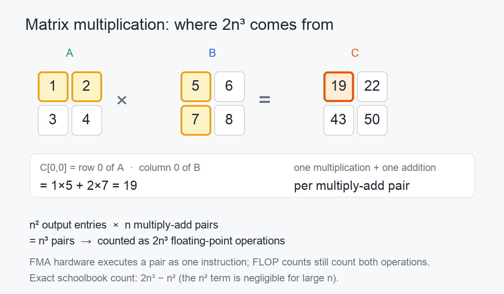

# Why matrix multiplication is counted as 2n³ FLOPs

> Based on a DeepSeek conversation about the factor of two in `2n³`: [shared conversation](https://chat.deepseek.com/share/pfp7rzsg281zolf4dm).

A matrix multiply of two `n × n` matrices is commonly said to perform:

```text
2n³ floating-point operations
```

The `2` comes from counting a multiplication and an addition separately. It is a convention, but a useful and consistent one.



*One output entry is the dot product of a row of A and a column of B. Each term contributes one multiplication and one addition.*

## One output entry

For `C = A × B`, the entry at row `i`, column `j` is:

```text
C[i,j] = sum over k of A[i,k] * B[k,j]
```

Computing that dot product takes:

- `n` multiplications;
- `n − 1` additions, if the accumulation starts with the first product.

For a 2 × 2 example:

```text
C[0,0] = 1×5 + 2×7
       = 5 + 14
       = 19
```

That is two multiplications and one addition: three arithmetic operations for one output entry.

## Scaling to n × n

There are `n²` output entries.

Each entry needs `n` multiplications and approximately `n` additions. The conventional count treats each of the `n` terms as a multiply-add pair and charges two operations for it:

```text
n² entries × n pairs × 2 operations = 2n³ operations
```

The exact schoolbook count is slightly smaller:

```text
n³ multiplications + n²(n − 1) additions = 2n³ − n² operations
```

For large `n`, the `n²` term is negligible compared with `n³`, so `2n³` is the usual estimate. For `n = 2`, the exact count is 12 operations, while `2n³` gives 16. The approximation is intended for large matrices, not tiny examples.

## What a FLOP means

A **FLOP** is one floating-point operation. In this convention:

- one multiplication is one FLOP;
- one addition is one FLOP.

Modern processors often provide a **fused multiply-add** instruction, usually written FMA or FMA3. It computes:

```text
a × b + c
```

as a single instruction. If performance were measured in instructions, that would be one instruction. If it is measured in mathematical operations, it is two FLOPs.

The convention counts the multiply and the add separately.

## Why the convention persists

Counting an FMA as two FLOPs keeps performance numbers comparable across hardware.

If one processor performs separate multiply and add instructions and another uses one FMA instruction, counting instructions would make the second processor appear to do half as much work for the same calculation. Counting mathematical operations avoids that distortion.

The convention also predates FMA. Early processors had separate multiply and add instructions, so counting them separately was natural. When FMA arrived, the existing FLOP convention remained in use.

The result is that **peak TFLOPS** figures usually assume the two-FLOPs-per-multiply-add convention. A processor with a given FMA throughput is advertised at twice that number in FLOPs.

A related unit is the **MAC**, for multiply-accumulate:

```text
1 MAC = 2 FLOPs
```

## What 2n³ does not mean

`2n³` is an operation count for the ordinary schoolbook matrix-multiplication algorithm. It is not a universal law for every matrix algorithm.

- Strassen's algorithm reduces the asymptotic exponent below 3, with different constants and practical tradeoffs.
- Sparse matrices perform fewer useful operations, but their performance depends on the sparsity pattern and storage format.
- Hardware sparsity features can skip zero work, so effective throughput may exceed the dense FLOP estimate.
- The exact arithmetic count is `2n³ − n²`, not exactly `2n³`.

The estimate remains useful because it captures the dominant cubic cost and gives a common basis for comparing implementations and hardware.

## Summary

- One output entry is a dot product with `n` multiplications and about `n` additions.
- There are `n²` entries, giving roughly `2n³` operations.
- The `2` reflects counting multiplication and addition separately.
- FMA hardware performs both in one instruction, but the FLOP convention still counts two operations so TFLOPS figures remain comparable.
- The exact schoolbook count is `2n³ − n²`; `2n³` is the large-`n` approximation.

## Reference

- DeepSeek, [shared conversation](https://chat.deepseek.com/share/pfp7rzsg281zolf4dm).
