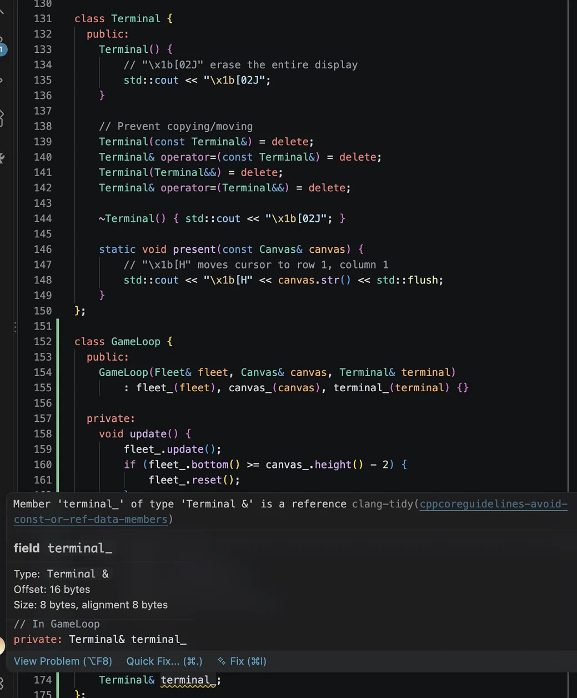

# Reference members, deleted copy operations, and rvalues

> A DeepSeek conversation on clang-tidy's reference-member warning in a GameLoop, deleting the four copy/move operations, and the meaning of temporaries and rvalues
>
> Source: [shared conversation](https://chat.deepseek.com/share/wdv2i3t40ve4qqdjyk) on chat.deepseek.com. 3 questions, 3 answers. The source link expires when the conversation is deleted from DeepSeek.
>
> Recovered from the shared-conversation HTML export: web citations and the attached screenshot preserved.

---

## User



*The screenshot that prompted the conversation: clang-tidy's `cppcoreguidelines-avoid-const-or-ref-data-members` warning on `GameLoop::terminal_`.*

---

## DeepSeek

The warning you are seeing is from **clang-tidy**, and it is pointing out a real design issue in your `GameLoop` class. While your code will compile, the C++ Core Guidelines (specifically rule C.12) recommend avoiding reference data members in copyable or movable types.[[1]](https://llvm.github.io/www-releases/23.1.0/tools/clang/tools/extra/docs/clang-tidy/checks/cppcoreguidelines/avoid-const-or-ref-data-members.html)[[9]](https://github.com/isocpp/CppCoreGuidelines/commit/77b417578541778f6081736f9584addc23f75b2b)

### 🔍 Why the Warning Appears

The `GameLoop` class stores a `Terminal&` (a reference) as a member. This creates a problem for the compiler: a reference member cannot be reseated (rebound to a different object after initialization). Consequently, the compiler **cannot generate a copy assignment operator** (`operator=`) for `GameLoop`, because it cannot make the reference point to the other object's `terminal_`. This makes the class non-copy-assignable, which is rarely what you want.[[1]](https://llvm.github.io/www-releases/23.1.0/tools/clang/tools/extra/docs/clang-tidy/checks/cppcoreguidelines/avoid-const-or-ref-data-members.html)[[7]](https://stackoverflow.com/feeds/question/12387239#1)

### 🛠️ How to Fix It

You have a few options, depending on how you intend to use `GameLoop`.

**Option 1: Use a Pointer (Most Recommended)**\
A pointer avoids the reference member issue entirely. It can be null or reseated, and the class remains copy-assignable.

```cpp
class GameLoop {
    // ... private:
    Terminal* terminal_;  // Changed from Terminal& to Terminal*

public:
    GameLoop(Fleet& fleet, Canvas& canvas, Terminal& terminal)
        : fleet_(fleet), canvas_(canvas), terminal_(&terminal) {}

    // Update usages: terminal_->present(...);
};
```

**Option 2: Delete Copy Operations**\
If `GameLoop` is a top-level controller and should never be copied, you can explicitly delete the copy/move operations to silence the warning. This is a common pattern for classes with reference members.

```cpp
class GameLoop {
    // ... private:
    Terminal& terminal_;

public:
    GameLoop(Fleet& fleet, Canvas& canvas, Terminal& terminal)
        : fleet_(fleet), canvas_(canvas), terminal_(terminal) {}

    // Prevent copying/moving
    GameLoop(const GameLoop&) = delete;
    GameLoop& operator=(const GameLoop&) = delete;
    GameLoop(GameLoop&&) = delete;
    GameLoop& operator=(GameLoop&&) = delete;
};
```

**Option 3: Use `std::reference_wrapper`**\
If you want to keep reference semantics but make the class assignable, use `std::reference_wrapper<Terminal>`. It behaves like a reference but is a value type, allowing the compiler to generate the assignment operator.[[12]](https://stackoverflow.com/questions/79784939/how-do-i-follow-c-12-don-t-make-data-members-const-or-references-in-a-copyabl/79785185#79785185#1)

```cpp
class GameLoop {
    // ... private:
    std::reference_wrapper<Terminal> terminal_;

public:
    GameLoop(Fleet& fleet, Canvas& canvas, Terminal& terminal)
        : fleet_(fleet), canvas_(canvas), terminal_(terminal) {}
};
```

**Option 4: Suppress the Warning (Not Recommended)**\
If you are certain that storing a reference is the right design, you can suppress the warning. However, this is generally discouraged as it hides the underlying assignment issue.

```cpp
// NOLINTNEXTLINE(cppcoreguidelines-avoid-const-or-ref-data-members)
Terminal& terminal_;
```

Given that `Terminal` appears to be a non-owning dependency injected into `GameLoop`, **Option 1 (using a pointer)** is the most flexible, while **Option 2 (deleting copies)** is the cleanest if `GameLoop` is a unique, top-level object.

---

## User

For some reason, the warning disappeared after entering just `GameLoop(const GameLoop&) = delete;`

---

## DeepSeek

That is expected behavior! You found the core of the issue.

Here is exactly why that happened:

### The Root Cause

The clang-tidy warning `cppcoreguidelines-avoid-const-or-ref-data-members` is specifically triggered when a class has a reference member **and** the compiler is forced to implicitly generate a copy/move assignment operator (or if you explicitly default it).

Because a reference cannot be "reseated" (you cannot make `terminal_` point to a different `Terminal` after it has been initialized), the compiler cannot generate a valid `GameLoop& operator=(const GameLoop&)`.

### Why `= delete` Silences It

When you write:

```cpp
GameLoop(const GameLoop&) = delete;
```

You are telling the compiler, *"I am taking manual control of the copy semantics for this class. Do not try to generate them."*

Once you explicitly delete the copy constructor, the compiler implicitly **deletes the copy assignment operator** as well. Because the assignment operator no longer exists, the tool no longer has to worry about the compiler failing to generate it. The rule is satisfied because the dangerous operation is completely blocked.

### ⚠️ One Important Caveat

While deleting *just* the copy constructor silenced the warning, it is usually best practice to delete **all four** copy and move operations if your class holds a reference.

If you only delete the copy constructor, the compiler might still try to generate a **move constructor**. If it does, and you move a `GameLoop`, the new object will still hold a reference to the *original* `Terminal`.

To be completely safe and express your intent clearly, you should add the other three:

```cpp
// Prevent copying
GameLoop(const GameLoop&) = delete;
GameLoop& operator=(const GameLoop&) = delete;

// Prevent moving (since moving a reference is just copying it)
GameLoop(GameLoop&&) = delete;
GameLoop& operator=(GameLoop&&) = delete;
```

*(Note: In your original screenshot, your `Terminal` class actually already does exactly this—it deletes all four!)*

**Summary:** You successfully fixed the issue by telling the compiler not to generate the problematic assignment operator. Just make sure you delete the move operations too, so you don't accidentally create a moved `GameLoop` that points to the old `Terminal`.

---

## User

Can you explain each of the four deletes? It will help me remember them if I understand what each part does. Also explain "temporary object" and "rvalue".

---

## DeepSeek

This is a great question. Understanding the "Big Four" (or "Rule of Five") and the value categories (lvalues/rvalues) is a rite of passage in C++.

Let's break down exactly what each of those four `delete` statements prevents, and then we'll look at what a "temporary object" and an "rvalue" are.

---

### The 4 Deletes Explained

When you write `GameLoop(const GameLoop&) = delete;`, you are explicitly telling the compiler, "Do not allow this specific operation."

Here is what each one blocks:

**1. `GameLoop(const GameLoop&) = delete;`**

- **What it is:** The **Copy Constructor**.
- **What it does (if not deleted):** It creates a *new* object as a copy of an *existing* object.
- **When it's called:** `GameLoop loop2 = loop1;` or when passing `loop1` to a function by value.
- **Why delete it here:** If you copied `GameLoop`, the new copy would hold a reference to the exact same `Terminal` as the original. If one loop gets destroyed, the other loop is now holding a reference to a potentially dead terminal.

**2. `GameLoop& operator=(const GameLoop&) = delete;`**

- **What it is:** The **Copy Assignment Operator**.
- **What it does (if not deleted):** It overwrites an *already existing* object with the data from another existing object.
- **When it's called:** `loop2 = loop1;` (where both already exist).
- **Why delete it here:** C++ fundamentally cannot "re-point" a reference. If `loop2` already has a `terminal_` reference, and you try to copy-assign `loop1` into it, C++ would have to change `loop2.terminal_` to point to `loop1`'s terminal. Since references can't be reseated, the compiler would generate an error anyway. Deleting it makes the intent clear.

**3. `GameLoop(GameLoop&&) = delete;`**

- **What it is:** The **Move Constructor**.
- **What it does (if not deleted):** It creates a *new* object by "stealing" the resources (like dynamic memory) from a *temporary* object that is about to be destroyed.
- **When it's called:** `GameLoop loop2 = std::move(loop1);` or when returning a `GameLoop` from a function.
- **Why delete it here:** Moving a reference is exactly the same as copying a reference—the pointer address doesn't change. If you allow the move, the new object points to the same `Terminal`. You delete this to make the class strictly non-movable and non-copyable.

**4. `GameLoop& operator=(GameLoop&&) = delete;`**

- **What it is:** The **Move Assignment Operator**.
- **What it does (if not deleted):** It overwrites an *existing* object by "stealing" resources from a temporary object.
- **When it's called:** `loop2 = std::move(loop1);` (where both already exist).
- **Why delete it here:** Same reason as #2. You cannot reseat the reference inside `loop2`.

> **💡 Pro Tip for Remembering:**\
> The `&` or `&&` in the parenthesis tells you **what you are copying/moving from**.\
> The lack of `operator=` means it's a **constructor** (creating something new).\
> The presence of `operator=` means it's an **assignment** (overwriting something old).

---

### What is an "rvalue" and a "Temporary Object"?

To understand the `&&` (rvalue references) in the move operations, you first need to understand lvalues and rvalues.

#### 1. Lvalue (Locator Value)

An **lvalue** is an expression that refers to a memory location and can appear on the **left** side of an assignment (`=`). It has a name and a persistent address in memory.

- `int x = 5;` -> `x` is an lvalue.
- `GameLoop loop(...);` -> `loop` is an lvalue.
- You can take the address of an lvalue: `&x` is valid.

#### 2. Rvalue (Read Value)

An **rvalue** is a temporary value that does not have a permanent memory address (or its address cannot be accessed by your code). It is designed to be on the **right** side of an assignment. It exists only for the duration of the expression it's in.

- `5` is an rvalue.
- `x + y` is an rvalue (it produces a temporary result).
- You **cannot** do `&5` (you can't take the address of the number 5).

#### 3. Temporary Object

A **temporary object** is an unnamed object created by the compiler to hold the result of an expression, usually for a very short time (until the end of the full expression or the semicolon). It is a type of rvalue.

**Example:**

```cpp
GameLoop createLoop() {
    // ... setup ...
    return GameLoop(fleet, canvas, terminal); // This constructs a Temporary Object (rvalue)
}

int main() {
    // 'temp' is created from the temporary object returned by the function.
    GameLoop temp = createLoop(); 
}
```

#### How this ties to `&&` (Move Semantics)

Before C++11, when you passed a temporary object, it had to be deep-copied, which was slow. C++11 introduced **rvalue references (`&&`)**.

When the compiler sees you are assigning from an rvalue (a temporary object that is about to die anyway), it says, *"Oh, this temporary is about to be destroyed. Instead of copying its heavy resources, I'll just steal them!"* This is the **Move Constructor** (`GameLoop(GameLoop&&)`).

### Why we delete the moves in your case

In your `GameLoop`, moving the object doesn't "steal" anything useful. A reference is just an alias. If you "move" a `Terminal&`, the new `GameLoop` just gets a copy of the memory address of the `Terminal`.

By deleting all four, you are creating a class that is **Strictly Non-Copyable and Non-Movable**. This is the perfect pattern for a top-level "Manager" or "Controller" class (like `GameLoop` or `Terminal`) that has a unique lifetime and owns references to sub-systems.
