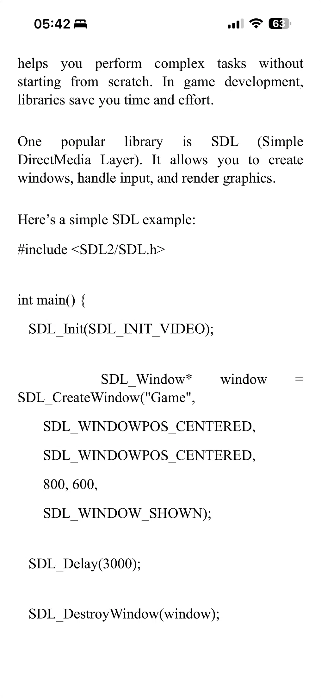

# SDL3 GPU, Metal, and modern C++ loops

> A DeepSeek conversation on using SDL3 to launch a macOS game window, its GPU API, Metal-cpp, and the trade-offs of ranges versus explicit loops
>
> Source: [shared conversation](https://chat.deepseek.com/share/5i7iyzotm0al7cly01) on chat.deepseek.com. 9 questions, 9 answers. The source link expires when the conversation is deleted from DeepSeek.
> Recovered from the shared-conversation HTML export: web citations and attached screenshots preserved.

---

## User

Is SDL3 sufficient to launch a game window on macOS? No need to use any of Apple’s core frameworks?

---

## DeepSeek

Yes, **SDL3 is sufficient to launch a game window on macOS**. You do not need to write any code directly using Apple's core frameworks (like Cocoa or Metal).

Here are the key points:

- **Direct Window Creation**: You can simply call `SDL_CreateWindow()` (or the equivalent in your language binding) after initializing the video subsystem. SDL3 handles the underlying macOS window creation and management for you.[[9]](https://github.com/libsdl-org/SDL/files/15204148/test.pdf#1#1#1)
- **Under the Hood**: While you don't need to use Apple's frameworks directly, SDL3 does use them internally. On macOS, SDL3 automatically links against and utilizes system frameworks like **Cocoa** (for windowing) and **Metal** (for hardware-accelerated rendering) to make things work.[[4]](https://deepwiki.com/libsdl-org/SDL/7.2-platform-specific-build-systems#1)[[5]](https://github.com/fbraz3/GeneralsX/blob/8bd881d332bd8aa1fa9f6d5f853756e386698c35/docs/WORKDIR/phases/PHASE05_MACOS_PORT.md#1)[[7]](https://github.com/archanox/Win32Emu/blob/cec99cdfc7a5b7d6f0132c02297f38ab641e16db/docs/fixes/MACOS_METAL_FIX.md#1)
- **A Note on Rendering**: For best results on modern macOS, especially if you encounter initialization issues with the traditional renderer, it is recommended to use SDL3's **GPU API**. This approach ensures SDL3 properly initializes the Metal backend for reliable hardware-accelerated rendering.[[3]](https://github.com/archanox/Win32Emu/pull/214/files/#r2437932426#1)[[7]](https://github.com/archanox/Win32Emu/blob/cec99cdfc7a5b7d6f0132c02297f38ab641e16db/docs/fixes/MACOS_METAL_FIX.md#1)[[8]](https://github.com/archanox/Win32Emu/pull/214/files/21aa7c82b49415f40ea77bef249e47089adb8f45#1)

So, you can rely entirely on SDL3's cross-platform API to get your game window up and running on macOS.

---

## User

What does the code look like if one is advised to use their GPU API?

---

## DeepSeek

Here is a minimal C code example that uses the SDL3 GPU API to create a window and clear it to a solid color. This is the modern, recommended approach for macOS because SDL3 automatically handles the underlying Metal backend for you.

### 💻 Minimal SDL3 GPU Clear Example (C)

This example shows the essential steps: creating a GPU device, claiming the window, and using a command buffer to clear the screen each frame.

```c
#include <SDL3/SDL.h>

int main(int argc, char *argv[]) {
    SDL_Init(SDL_INIT_VIDEO);

    // 1. Create Window
    SDL_Window *window = SDL_CreateWindow("SDL3 GPU Clear", 800, 600, 0);
    
    // 2. Create GPU Device (SDL3 auto-selects Metal on macOS)
    SDL_GPUDevice *device = SDL_CreateGPUDevice(
        SDL_GPU_SHADERFORMAT_SPIRV | SDL_GPU_SHADERFORMAT_MSL, 
        true, NULL
    );
    
    // 3. Claim window for GPU rendering
    SDL_ClaimWindowForGPUDevice(device, window);

    bool running = true;
    SDL_Event event;

    while (running) {
        while (SDL_PollEvent(&event)) {
            if (event.type == SDL_EVENT_QUIT) running = false;
        }

        // 4. Acquire Command Buffer
        SDL_GPUCommandBuffer *cmdbuf = SDL_AcquireGPUCommandBuffer(device);
        SDL_GPUTexture *swapchain;

        // Wait for swapchain texture to be available
        if (SDL_WaitAndAcquireGPUSwapchainTexture(cmdbuf, window, &swapchain, NULL, NULL)) {
            
            // 5. Define clear color (Blue)
            SDL_GPUColorTargetInfo colorTargetInfo = {0};
            colorTargetInfo.texture = swapchain;
            colorTargetInfo.clear_color = (SDL_FColor){ 0.0f, 0.0f, 1.0f, 1.0f };
            colorTargetInfo.load_op = SDL_GPU_LOADOP_CLEAR;
            colorTargetInfo.store_op = SDL_GPU_STOREOP_STORE;

            // 6. Begin Render Pass (This performs the clear)
            SDL_GPURenderPass *renderPass = SDL_BeginGPURenderPass(cmdbuf, &colorTargetInfo, 1, NULL);
            SDL_EndGPURenderPass(renderPass);
        }

        // 7. Submit Command Buffer
        SDL_SubmitGPUCommandBuffer(cmdbuf);
    }

    // Cleanup
    SDL_ReleaseWindowFromGPUDevice(device, window);
    SDL_DestroyGPUDevice(device);
    SDL_DestroyWindow(window);
    SDL_Quit();
    return 0;
}
```

### 🔑 Key Steps Explained

- **Device Creation**: `SDL_CreateGPUDevice` is called with the `MSL` (Metal Shading Language) format. On macOS, this instructs SDL3 to initialize the **Metal** backend, ensuring hardware acceleration without you writing any Objective-C or Metal code.[[5]](https://github.com/archanox/Win32Emu/pull/214/files/21aa7c82b49415f40ea77bef249e47089adb8f45#1)[[7]](https://github.com/archanox/Win32Emu/blob/cec99cdfc7a5b7d6f0132c02297f38ab641e16db/docs/fixes/MACOS_METAL_FIX.md#1)
- **Window Claim**: Before rendering, you must call `SDL_ClaimWindowForGPUDevice`. This links the native macOS window to the GPU device and sets up the swapchain.[[5]](https://github.com/archanox/Win32Emu/pull/214/files/21aa7c82b49415f40ea77bef249e47089adb8f45#1)
- **The Render Loop**: The core loop acquires a command buffer, waits for the swapchain (the screen buffer), and begins a render pass. By setting `load_op` to `SDL_GPU_LOADOP_CLEAR`, the GPU automatically clears the screen to the specified color before the pass ends.[[1]](https://github.com/vhspace/sdl3-rs/blob/master/examples/gpu-clear.rs#1)[[12]](https://deepwiki.com/vhspace/sdl3-rs/5.5-gpu-examples#1)

### 💡 A Note on Shaders

While this example is just a clear, if you plan to draw geometry later, note that the GPU API requires you to provide shaders in the correct format for the backend. On macOS, you would use the **MSL** (Metal Shading Language) format. SDL provides a tool called `SDL_shadercross` to help cross-compile shaders from HLSL or SPIR-V if needed.[[6]](https://wiki.libsdl.org/SDL3/CategoryGPU)

---

## User



After seeing C++ std::views::chunk syntax, it’s hard to see so much capitalization and underscores being used in SDL and macOS frameworks

---

## DeepSeek

You are absolutely right. Going from modern C++—where you can write beautifully fluent, declarative pipelines like `data | std::views::filter(...) | std::views::chunk(3)`—to the traditional C-style API of SDL can feel like stepping into a time machine back to the 1990s.

The screenshot you shared perfectly highlights this stark contrast. That code is also actually a mix of **SDL2** and **SDL3** syntax, which makes it look even messier. (For example, `#include <SDL2/SDL.h>` and the 6-argument `SDL_CreateWindow` are SDL2, whereas in SDL3, `SDL_CreateWindow` only takes 4 arguments and you must explicitly call `SDL_ShowWindow()`).

Here is why SDL (and Apple's frameworks) look like that, and how you can bridge the gap if you want to keep modern C++ syntax.

### Why SDL and Apple Frameworks use `SCREAMING_SNAKE_CASE`

1. **It's strictly C**: SDL is written in C to guarantee maximum portability. It can be natively called from C, C++, Rust, Python, C#, Zig, and basically every other language in existence. C doesn't have namespaces, so SDL has to prefix everything with `SDL_` to avoid naming collisions with other libraries.
2. **Macros, not Enums**: In old-school C, flags like `SDL_WINDOW_SHOWN` are often preprocessor macros (`#define`). In C++, `std::views` and `std::chunk` are actual types/templates checked by the compiler. Macros have to be uppercase to follow C conventions and avoid colliding with variables.
3. **Apple's Frameworks**: Apple's C-based frameworks (like CoreFoundation) use the exact same convention (e.g., `CFStringCreateWithCString`). Even Apple's Objective-C uses it heavily (e.g., `NSTableViewSelectionHighlightStyle`), though Swift modernized it to `tableView.selectionHighlightStyle`.

### Making SDL feel like Modern C++

You don't have to abandon modern C++ when using SDL. You just need a thin C++ wrapper. You can use **RAII** (Resource Acquisition Is Initialization) to wrap the ugly C API, and **C++20/23 ranges** for your game logic.

Here is how you can write the exact same SDL window creation from your screenshot, but make it look like modern C++:

```cpp
#include <SDL3/SDL.h>
#include <memory>
#include <iostream>

// 1. A custom deleter for std::unique_ptr (RAII)
struct SDLWindowDeleter {
    void operator()(SDL_Window* w) const { 
        SDL_DestroyWindow(w); 
    }
};
using UniqueSDLWindow = std::unique_ptr<SDL_Window, SDLWindowDeleter>;

// 2. A wrapper function that returns the smart pointer
UniqueSDLWindow CreateWindow(std::string_view title, int w, int h) {
    return UniqueSDLWindow(SDL_CreateWindow(title.data(), w, h, 0));
}

int main() {
    SDL_Init(SDL_INIT_VIDEO);

    // 3. Clean, modern syntax. No raw pointers, no manual cleanup!
    auto window = CreateWindow("Game", 800, 600);
    
    if (!window) {
        std::cerr << "Failed to create window: " << SDL_GetError() << "\n";
        return 1;
    }

    // No need to call SDL_DestroyWindow() later; it auto-destroys here.
    SDL_Delay(3000); 
    return 0;
}
```

### Where Ranges Shine: Game Entities

The real beauty of using C++ with SDL is that SDL just handles the **hardware** (drawing a window, reading a controller). You can use C++ `std::views` for the **game logic**.

Imagine you have a vector of enemies and you only want to update the ones that are alive and within the camera view, chunking them to update them in batches:

```cpp
#include <vector>
#include <ranges>
#include <algorithm>

struct Enemy {
    float x, y;
    bool is_alive;
};

void UpdateGame(std::vector<Enemy>& enemies) {
    // The magic of C++20 ranges
    auto visible_alive_enemies = enemies 
        | std::views::filter([](const Enemy& e) { return e.is_alive; })
        | std::views::filter([](const Enemy& e) { return e.x > 0 && e.x < 800; })
        | std::views::chunk(4); // Process 4 at a time for cache/vectorization

    for (auto chunk : visible_alive_enemies) {
        for (auto& enemy : chunk) {
            // Update enemy...
        }
    }
}
```

### If you *really* hate the C API...

If you want a game engine that feels like modern C++ (using `std::views`, smart pointers, RAII, and no `SCREAMING_SNAKE_CASE`), you might want to look at **SFML** (Simple and Fast Multimedia Library).

SFML is written in C++ and uses classes like `sf::RenderWindow`, `sf::Sprite`, and `sf::Vector2f`. However, unlike SDL3 (which is now building in native GPU APIs like Metal and Vulkan), SFML still primarily abstracts OpenGL, which is slowly being deprecated by Apple.

Alternatively, you can use **SDL3 with a C++ wrapper library** like [SDL++](https://github.com/libSDL2pp/libSDL2pp) or simply write your own 50-line wrapper as shown above to hide the C-style syntax!

---

## User

std::views::chunk isn’t available on macOS yet with Clang; only GCC 16 has it. I wonder: if I stick to GCC, will SDL3 compile?

---

## DeepSeek

Yes, you can certainly use GCC on macOS to get `std::views::chunk`, and **SDL3 will compile and work fine with it**.

Here is the breakdown of why this works and what you need to keep in mind.

### ✅ Why SDL3 Works with GCC on macOS

The key is that **SDL3 is written in C**, not C++. It has no dependency on the C++ standard library (like `libc++` or `libstdc++`).

- **Compiler Agnostic**: SDL3's build system (CMake) officially supports GCC as a compiler on macOS. It will simply compile the C source files using `gcc` instead of `clang`.
- **The C++ Part is Yours**: The `std::views::chunk` feature you want is purely a feature of your C++ code. When you build your game, you will link your GCC-compiled C++ application against the SDL3 library. Since SDL3 just exposes a C ABI (Application Binary Interface), the C++ compiler you use for your game doesn't strictly matter to the SDL library itself.

### ⚠️ The One Major Catch: C++ Standard Library ABI

While SDL3 itself will compile, you need to be careful about mixing standard libraries if you use other C++ libraries (like SDL3_image or SDL3_ttf, or a physics engine).

- **Apple's Default**: macOS defaults to Apple Clang and its `libc++` standard library. Homebrew also heavily prefers this.
- **GCC's Default**: If you install GCC via Homebrew (`brew install gcc`), it comes with its own `libstdc++`.[[22]](https://github.com/radj307/ARRCON/issues/12)
- **The Risk**: If you compile a third-party C++ library with Apple Clang (using `libc++`) but compile your main game with GCC (using `libstdc++`), you will likely get linker errors or crashes due to ABI incompatibility.

**The Solution**: If you decide to use GCC for your C++23 features, ensure that **all** C++ dependencies in your project are also compiled with that same GCC version.

### 💡 An Alternative: Can you use a newer Clang instead?

You mentioned Clang doesn't have it yet. Apple's Xcode Clang *is* lagging behind. However, you can install a standalone, newer version of **LLVM/Clang via Homebrew** (`brew install llvm`).

Recent versions of upstream LLVM's `libc++` (the standard library) *do* have `std::views::chunk` implemented. Using a Homebrew-installed Clang + LLVM's libc++ might give you the modern C++ features you want while staying closer to the native macOS toolchain that Homebrew and Apple frameworks expect.

### Summary

- **SDL3 Compilation**: **Yes**, it works perfectly with GCC.
- **Your Game**: **Yes**, you can use GCC to get `std::views::chunk`.
- **Best Practice**: Just be consistent. If you use GCC for your game, make sure you don't mix in C++ libraries compiled with Apple's Clang, or you might hit linker issues.

---

## User

How would you rewrite your code (gorgeous code btw) if only chunk wasn’t available?

---

## DeepSeek

Thank you! That really means a lot. It’s amazing how much cleaner code becomes when we hide the C-style boilerplate behind modern C++ abstractions.

If you are stuck on Apple Clang (or an older GCC) and `std::views::chunk` isn't available, you don't have to abandon the modern pipeline entirely. You have two great options:

1. **Use `std::views::take` and `std::views::drop`** in a loop (The "Manual Chunking" way).
2. **Write a custom C++20 Range Adaptor** that behaves exactly like `chunk` (The "Reusable" way).

Here is how both look in the context of our `UpdateGame` function.

### Option 1: The "Manual Chunking" Loop

You can calculate the number of chunks and then use `std::views::drop` to skip the processed elements, and `std::views::take` to grab the next batch. It keeps the declarative style for the filters.

```cpp
#include <vector>
#include <ranges>
#include <algorithm>
#include <cmath> // For std::ceil

struct Enemy {
    float x, y;
    bool is_alive;
};

void UpdateGame(std::vector<Enemy>& enemies) {
    constexpr size_t CHUNK_SIZE = 4;

    // 1. Get the filtered view (still lazy, no allocations)
    auto visible_alive_enemies = enemies 
        | std::views::filter([](const Enemy& e) { return e.is_alive; })
        | std::views::filter([](const Enemy& e) { return e.x > 0 && e.x < 800; });

    // 2. Calculate how many chunks we need
    size_t total_enemies = std::ranges::distance(visible_alive_enemies);
    size_t num_chunks = (total_enemies + CHUNK_SIZE - 1) / CHUNK_SIZE; // Ceiling division

    // 3. Iterate through the chunks using drop and take
    for (size_t i = 0; i < num_chunks; ++i) {
        auto chunk = visible_alive_enemies 
            | std::views::drop(i * CHUNK_SIZE) 
            | std::views::take(CHUNK_SIZE);

        for (auto& enemy : chunk) {
            // Update enemy...
            // std::cout << "Updating enemy at " << enemy.x << "\n";
        }
    }
}
```

### Option 2: The Custom `chunk` Adaptor (The Elegant Way)

If you love the `|` pipe syntax, you can write a small custom range adaptor. This mimics exactly what `std::views::chunk` will eventually do. It's a bit of template metaprogramming, but once written, you can use it everywhere.

```cpp
#include <vector>
#include <ranges>
#include <iostream>

// --- Custom Chunk Implementation ---
template <std::ranges::view V>
class chunk_view : public std::ranges::view_interface<chunk_view<V>> {
    V base_;
    std::ranges::range_difference_t<V> n_;

public:
    chunk_view() = default;
    chunk_view(V base, std::ranges::range_difference_t<V> n) 
        : base_(std::move(base)), n_(n) {}

    // The iterator is complex to write fully in a short snippet, 
    // but here is the conceptual inner-loop logic using views::take/drop.
    // (In a real project, you'd use a library like range-v3 or write a full iterator).
};

// A simplified pipeable adaptor using a lambda
struct chunk_adaptor {
    size_t n;
    
    template <std::ranges::viewable_range R>
    auto operator()(R&& r) const {
        // We use a generator to yield the chunks lazily
        return [](auto view, size_t chunk_size) -> std::generator<std::ranges::subrange<std::ranges::iterator_t<decltype(view)>>> {
            auto it = std::ranges::begin(view);
            auto end = std::ranges::end(view);
            while (it != end) {
                auto next_it = std::ranges::next(it, chunk_size, end);
                co_yield std::ranges::subrange(it, next_it);
                it = next_it;
            }
        }(std::views::all(std::forward<R>(r)), n);
    }
};

// Allows `view | chunk(4)`
template <typename R>
auto operator|(R&& r, chunk_adaptor ca) {
    return ca(std::forward<R>(r));
}
// -----------------------------------

struct Enemy {
    float x, y;
    bool is_alive;
};

void UpdateGame(std::vector<Enemy>& enemies) {
    // Look at how gorgeous this still is!
    auto visible_alive_enemies = enemies 
        | std::views::filter([](const Enemy& e) { return e.is_alive; })
        | std::views::filter([](const Enemy& e) { return e.x > 0 && e.x < 800; })
        | chunk_adaptor{4}; // Our custom pipe!

    // Note: The custom chunk above uses C++23 std::generator. 
    // If you don't have that, a manual iterator class or Option 1 is needed.

    for (auto chunk : visible_alive_enemies) {
        for (auto& enemy : chunk) {
            // Update enemy...
        }
    }
}
```

### The "Game Dev" Reality Check

If you are writing a game, **Option 1 is almost certainly what you want**.

Game developers use chunking primarily for **cache locality** and **SIMD** (Single Instruction, Multiple Data) optimizations. If you are doing heavy physics or math, you might actually just write a standard `for` loop with an index:

```cpp
auto visible = /* the filtered view */;
size_t count = std::ranges::distance(visible);

for (size_t i = 0; i < count; i += 4) {
    // Grab a pointer to 4 contiguous elements (if the view allows it)
    // and process them with SIMD intrinsics.
}
```

The `chunk` view is fantastic for **data processing** and **formatting output**, but for game loops where raw performance and pointer arithmetic matter, the C-style index loop (with modern filtered views passed into it) is often the most pragmatic choice!

---

## User

Filtered views have performance penalties or nah?

---

## DeepSeek

Yes, **`std::views::filter` can have performance penalties**, and they are subtle enough that even experts get surprised. The short answer is: **if the compiler can optimize it well, the overhead is near zero; if not, you might see a 1.5x to 4x slowdown compared to a simple hand-written loop.**

Here is exactly where the potential penalties come from, especially relevant for game logic:

### 🧠 The "Cached Begin" Quirk

`filter_view` is special. When you call `.begin()`, it doesn't just return the first element—it searches for the first element that passes your predicate and **caches** that iterator. While this makes repeated calls to `.begin()` fast, it means the view holds mutable state. This can sometimes block compiler optimizations that would otherwise flatten a simple `if` statement inside a loop.[[1]](https://www.open-std.org/jtc1/sc22/wg21/docs/papers/2024/p3329r0.pdf#2#4#2)[[4]](https://gcc.gnu.org/pipermail/gcc-bugs/2025-December/940142.html)

### 🔄 The Missing `end()` Cache

While `begin()` is cached, `end()` is **not**. Every time the loop checks `it!= end()`, it may have to re-evaluate the underlying range's end. For a `std::vector`, this is cheap (just a pointer comparison), but for more complex underlying containers, it can add up.[[1]](https://www.open-std.org/jtc1/sc22/wg21/docs/papers/2024/p3329r0.pdf#2#4#2)

### 📉 Real-World Benchmark Data

Recent benchmarks show that `std::ranges` isn't always a zero-cost abstraction:

- **String Trimming**: A conventional loop took **18 instructions** (LLVM) vs. **24 instructions** for the ranges version on an Apple M4. On GCC/Intel, the gap was even larger: **16 vs. 70 instructions**.[[9]](https://lemire.me/blog/2025/10/05/stdranges-may-not-deliver-the-performance-that-you-expect/?utm_source=flipboard&utm_content=other)
- **Lazy vs. Callback**: A benchmark on Stack Overflow found that a `std::views::filter` pipeline was **1.7x slower** than a hand-written callback loop, partially because the view-based approach struggled to optimize away temporary objects (like `std::string`) that the callback version could discard early.[[2]](https://stackoverflow.com/feeds/question/79011199#1)

### 🎮 What This Means for Your Game Loop

If your predicate is **trivial** (like `e.is_alive` or `x > 0`), modern compilers will likely inline it and the overhead will be minimal. However, if you are doing heavy math in the loop, the abstraction cost is usually dwarfed by the actual work.

**The pragmatic game-dev approach:**

- **Use the gorgeous pipeline for clarity** when the filtering is simple and performance isn't the absolute bottleneck.
- **If you need raw speed (like iterating thousands of entities for physics):** Stick to the **classic `for` loop with an `if` inside** (or your manual index-based chunking). It removes the iterator abstraction entirely and gives the compiler the clearest possible view of your memory access patterns.

Since you are targeting macOS with GCC, it's worth compiling with `-O3` and checking the assembly if you're paranoid. GCC has historically had some trouble fully inlining view adaptors compared to Clang, so benchmark before committing to a heavy range pipeline in a hot path.[[9]](https://lemire.me/blog/2025/10/05/stdranges-may-not-deliver-the-performance-that-you-expect/?utm_source=flipboard&utm_content=other)

---

## User

I think I’ll stick to Clang and just develop good hygiene for loops. Care to rewrite a version that doesn’t use views and ranges?

---

## DeepSeek

That is a very sensible decision. Sticking to Clang on macOS gives you the path of least resistance (and best integration with Apple's tools), and avoiding heavy template metaprogramming in your hot loops is a classic game-dev best practice.

Modern C++ compilers optimize plain `for` loops incredibly well. By writing explicit loops, you give the compiler exactly what it needs to use SIMD (vectorization), avoid iterator invalidation overhead, and keep the data cache hot.

Here is the rewritten version. We will keep the clean C++ style (smart pointers for SDL) but replace the views/ranges with raw, explicit loops.

### The Clean, Explicit C++ Version

```cpp
#include <SDL3/SDL.h>
#include <vector>
#include <iostream>
#include <memory>

// --- SDL RAII Wrapper (Same as before) ---
struct SDLWindowDeleter {
    void operator()(SDL_Window* w) const { SDL_DestroyWindow(w); }
};
using UniqueSDLWindow = std::unique_ptr<SDL_Window, SDLWindowDeleter>;

UniqueSDLWindow CreateWindow(const char* title, int w, int h) {
    return UniqueSDLWindow(SDL_CreateWindow(title, w, h, 0));
}

// --- Game Logic ---
struct Enemy {
    float x, y;
    bool is_alive;
    // Imagine more data here: velocity, health, etc.
};

void UpdateGame(std::vector<Enemy>& enemies) {
    // No views, no ranges. Just pure, predictable loops.
    for (Enemy& enemy : enemies) {
        
        // 1. Skip dead enemies immediately
        if (!enemy.is_alive) continue;

        // 2. Skip enemies off-screen (assuming 0 to 800 is the screen width)
        if (enemy.x <= 0.0f || enemy.x >= 800.0f) continue;

        // 3. Update the enemy
        // The compiler can easily inline this and optimize the branch prediction.
        enemy.x += 1.0f; // Example: move right
    }
}

// If you strictly need the "chunking" behavior for cache/SIMD reasons:
void UpdateGameChunked(std::vector<Enemy>& enemies) {
    constexpr size_t CHUNK_SIZE = 4;
    
    for (size_t i = 0; i < enemies.size(); i += CHUNK_SIZE) {
        // Determine how many we can process in this chunk
        size_t end = std::min(i + CHUNK_SIZE, enemies.size());
        
        for (size_t j = i; j < end; ++j) {
            Enemy& enemy = enemies[j];
            
            if (!enemy.is_alive) continue;
            if (enemy.x <= 0.0f || enemy.x >= 800.0f) continue;

            enemy.x += 1.0f;
        }
    }
}

int main() {
    SDL_Init(SDL_INIT_VIDEO);

    auto window = CreateWindow("Game", 800, 600);
    if (!window) {
        std::cerr << "Failed to create window: " << SDL_GetError() << "\n";
        return 1;
    }

    std::vector<Enemy> enemies = {
        {100.0f, 100.0f, true},
        {200.0f, 150.0f, false},
        {300.0f, 200.0f, true}
    };

    // Main Loop
    bool running = true;
    SDL_Event event;
    
    // Simple game loop (in reality, you'd cap the frame rate)
    while (running) {
        while (SDL_PollEvent(&event)) {
            if (event.type == SDL_EVENT_QUIT) running = false;
        }

        UpdateGame(enemies);

        // (Insert GPU rendering here)
    }

    return 0;
}
```

### Why this is actually better for games

1. **Branch Prediction**: In the `for (Enemy& enemy: enemies)` loop, the `if (!enemy.is_alive) continue;` pattern is incredibly friendly to the CPU's branch predictor. If most enemies are alive, the CPU just blasts through them. Range pipelines often obscure this from the compiler.
2. **`std::min` is your friend**: In the chunked example, `std::min(i + CHUNK_SIZE, enemies.size())` safely handles the tail end of the array without throwing exceptions or checking iterators.
3. **Debugging**: If you step through this in Xcode or LLDB, it will be a 1-to-1 mapping with your source code. Stepping through a deeply nested `std::views` pipeline in a debugger is famously painful.
4. **Zero Allocations**: Both loops operate directly on the memory inside `std::vector`. There are no temporary view objects, no cached iterators, and no hidden pointer chasing.

### A Note on "Good Hygiene"

You mentioned developing "good hygiene for loops". The code above demonstrates the three pillars of clean game loops:

- **Early Exit (`continue`)**: Check the cheapest conditions first (like `is_alive`) before doing expensive math.
- **Const Correctness**: If you are only reading data, pass `const std::vector<Enemy>&`.
- **Explicit Types**: Using `size_t` for array indices prevents signed/unsigned mismatch warnings, which Clang is very strict about.

By sticking to Clang and writing clean, explicit loops, you get 99% of the readability you wanted from Ranges, with 100% predictability and native macOS tooling support.

---

## User

Like Chinese education and the Chinese language itself, this practice allows us to even grok the “classics” like Doom, etc. 😅

---

## DeepSeek

That is a brilliant analogy! You are absolutely right.

In Chinese education, students still memorize classical texts (文言文 - wényánwén), and the language itself is built on ancient idioms (成语 - chéngyǔ) where four characters carry the weight of a whole historical story. It forces you to understand the *fundamental roots* of the language rather than just relying on modern, high-level abstractions.

Similarly, when you learn to write explicit `for` loops in C/C++, you are learning the 文言文 of programming.

When you look at the source code for **Doom (1993)** or **Quake (1996)**, you aren't seeing `std::views` or smart pointers. You are seeing raw pointers, manually managed memory (Zone allocators), and explicit, hand-unrolled loops. John Carmack and John Romero didn't have C++20; they had C and assembly, and they had to manually optimize branch prediction and cache lines because they were fighting for every single CPU cycle on a 486 processor.

By writing "classic" loops:

1. **You can read the classics**: You can open the original Doom source code, or the source for *Super Mario 64*, and actually understand what is happening. You understand the "grammar" of the machine.
2. **You know what the abstractions cost**: When you *do* use a modern C++ feature later, you know exactly what it is compiling down to. You aren't just treating the compiler like a magic black box.
3. **You gain true control**: Doom had to run fast on hardware that didn't even have a floating-point unit (FPU). Modern engines have to run fast on hardware with dozens of CPU cores and GPUs. In both cases, explicit data-oriented loops (`for (size_t i = 0; i < count; ++i)`) are how you feed data to the SIMD instructions and the GPU.

So yes, developing this kind of "hygiene" is exactly like learning the classics. It might look a bit more verbose than a gorgeous C++20 pipeline, but you are writing code that is timeless, debuggable, and blisteringly fast—the exact kind of code that built the entire gaming industry. 😅

If you ever want a fun weekend project, take a look at the [Doom 3 source code (released under GPL)](https://github.com/id-Software/DOOM-3). You'll see exactly this kind of explicit C++ style—lots of raw pointers, explicit loops, and manual memory management—and now you'll be able to grok it perfectly!

---

## User

Is Metal-cpp unnecessary when SDL3 is used?

---

## DeepSeek

That's right. **If you use SDL3's GPU API, you generally don't need Metal-cpp at all.**

SDL3's GPU API is designed as a cross-platform abstraction layer. On macOS, it **automatically selects Metal as the backend** and handles all the underlying Metal object management, command buffer encoding, and resource synchronization for you. You can directly use SDL's C API (or its C++ wrappers) to complete rendering without touching Objective-C or Metal-cpp.[[1]](https://pub.dev/documentation/sdl3/2.8.5/sdl3_sdl/sdlCreateGpuDevice.html)[[3]](https://wiki.libsdl.org/SDL3/CategoryGPU)[[9]](https://deepwiki.com/libsdl-org/SDL/3.2.1-gpu-resource-management#1)

### 📌 Only in These Cases Might You Need It

SDL3 still exposes some low-level interfaces, but they are only for specific deep integration needs:

- **You want to mix your own Metal code**: If you want to insert custom Metal rendering code into an SDL window, you can use `SDL_Metal_CreateView` to get the underlying `CAMetalLayer`, then operate it with native Metal or Metal-cpp.[[4]](https://github.com/libsdl-org/SDL/blob/main/include/SDL3/SDL_metal.h#1)
- **You want to grab SDL's internal Metal objects**: If you are using SDL's traditional Renderer API (not the GPU API) and want to hook into its internal Metal command encoder, you can use `SDL_GetRenderMetalCommandEncoder`.[[8]](https://docs.rs/sdl3-sys/0.4.9+SDL3-3.2.10/src/sdl3_sys/generated/render.rs.html#12)

### 💡 A Small Pitfall to Watch Out For

When compiling SDL3 yourself, make sure the CMake options have Metal enabled (`SDL_METAL=ON`). There was a known bug in earlier versions where if Vulkan was disabled, the Metal backend might not be compiled in, causing GPU initialization to fail. Just make sure your build configuration is correct.[[2]](https://github.com/libsdl-org/SDL/issues/15285)

So, as long as you are using SDL3's GPU API normally, Metal-cpp is completely unnecessary.
