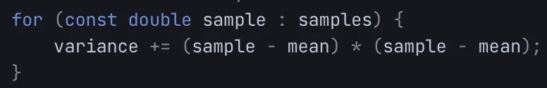

# Squaring and integer powers in C++

> Based on a DeepSeek conversation about squaring a variance term, `^` versus exponentiation, and fast integer powers: [shared conversation](https://chat.deepseek.com/share/wrrmh5qjozsr8c83lf).

A variance loop often contains a repeated product:



```cpp
for (const double sample : samples) {
    variance += (sample - mean) * (sample - mean);
}
```

The repeated `(sample - mean)` prompts a reasonable question: is there a cleaner way to square a value in C++?

There is no standard `std::square`, and no exponentiation operator. For this expression, `x * x` is the normal choice.

## The immediate improvement: name the difference

The arithmetic is correct, but the expression repeats itself:

```cpp
for (const double sample : samples) {
    const double diff = sample - mean;
    variance += diff * diff;
}
```

This is easier to read and avoids asking the reader to verify that both factors are identical. The compiler can reuse the subtraction even in the original form, so the temporary is primarily a readability improvement.

## No standard square function

C++ has no `std::square` in C++23. The direct product is idiomatic:

```cpp
double square(double x) {
    return x * x;
}
```

A dedicated function is useful when it has a domain-specific name, but for one expression, `x * x` is already clear and fast.

## `std::pow` is not the right tool for squaring

`<cmath>` provides:

```cpp
double y = std::pow(x, 2);
```

This computes `x` raised to the power 2, but `std::pow` is a general exponentiation function. It must handle non-integer and negative exponents, special values, and different floating-point types.

For a simple square, `x * x` is preferable because it:

- has no function-call overhead when not inlined;
- expresses exactly one multiplication;
- does not depend on the compiler recognizing a special case of `pow`;
- handles the arithmetic directly.

Compilers often optimize `std::pow(x, 2)` to `x * x` at high optimization levels. That optimization is useful, but it is not a reason to write `pow` when a multiplication is clearer.

## `^` is XOR, not exponentiation

For developers coming from Python, R, Ruby, JavaScript, or MATLAB, the biggest surprise is this:

```cpp
double y = x ^ 2;  // bitwise XOR, not x squared
```

In C++, `^` is the bitwise exclusive-or operator. It works on integer operands. For example:

```text
3 in binary: 011
2 in binary: 010
XOR result:  001  = 1
```

So `3 ^ 2` is `1`, not `9`.

C++ also has no `**` operator. The language has no exponentiation operator at all.

## Why C++ is different

C++ inherits most of its operators from C, which was designed for systems programming. Operators such as `+`, `*`, `&`, and `^` map directly to simple machine instructions.

A processor has an XOR instruction. It does not generally have a single instruction for arbitrary exponentiation. If `^` meant exponentiation, the operator would sometimes compile to a single instruction and sometimes to a library call, which would violate the expectation that operators are predictable and cheap.

C++ can overload operators for user-defined types, but it cannot give `double` or `int` a new meaning. A custom numeric class could define `operator^`, but doing so would be confusing because `^` already means XOR for built-in types.

## Other languages use different spellings

| Language | Exponentiation |
| --- | --- |
| Python | `**` |
| R | `^` |
| JavaScript | `**` |
| Ruby | `**` |
| MATLAB | `^`, with `.*`/`.^` variants for element-wise work |
| C++ | `std::pow` or explicit multiplication |

The difference is historical and syntactic, not a statement that C++ cannot compute powers.

## Constant powers: `x^6` and `x^8`

For a compile-time constant exponent, repeated squaring reduces the number of multiplications. For `x^8`:

```cpp
const double x2 = x * x;
const double x4 = x2 * x2;
const double x8 = x4 * x4;
```

That is three multiplications instead of seven.

For `x^6`:

```cpp
const double x2 = x * x;
const double x3 = x2 * x;
const double x6 = x3 * x3;
```

Again, three multiplications.

The compiler may also optimize `std::pow(x, 6)` into a similar sequence when the exponent is a compile-time constant. The explicit form makes the work visible and does not depend on that transformation.

A reusable `constexpr` template can express the same algorithm:

```cpp
template <int N, typename T>
constexpr T ipow(T base) {
    static_assert(N >= 0);

    if constexpr (N == 0) {
        return T{1};
    } else if constexpr (N == 1) {
        return base;
    } else {
        const T half = ipow<N / 2>(base);

        if constexpr (N % 2 == 0) {
            return half * half;
        } else {
            return half * half * base;
        }
    }
}
```

`ipow<8>(x)` performs three squarings, and `ipow<6>(x)` performs three multiplications. The recursion is resolved at compile time.

## Runtime exponents: exponentiation by squaring

When the exponent is known only at runtime, a loop performs exponentiation by squaring:

```cpp
double fast_pow(double base, int exp) {
    if (exp < 0) {
        base = 1.0 / base;
        exp = -exp;
    }

    double result = 1.0;

    while (exp > 0) {
        if (exp & 1) {
            result *= base;
        }

        base *= base;
        exp >>= 1;
    }

    return result;
}
```

For `fast_pow(x, 6)`, the exponent 6 is binary `110`:

1. `exp` is even. Do not multiply the result. Square the base to `x²`; halve the exponent to 3.
2. `exp` is odd. Multiply the result by `x²`. Square the base to `x⁴`; halve the exponent to 1.
3. `exp` is odd. Multiply the result by `x⁴`, giving `x⁶`. Square the base to `x⁸`; halve the exponent to 0.
4. Done.

The loop uses three multiplications plus the bookkeeping, rather than six successive multiplications. Its cost is O(log n) rather than O(n).

## Why `& 1` and `>> 1` work

For a non-negative integer, two pairs of operations are equivalent:

```text
exp % 2 == 1     ↔     exp & 1
exp / 2          ↔     exp >> 1
```

The first pair tests the least-significant bit; the second drops it.

In base 10, dividing by 10 removes the last digit. In base 2, dividing by 2 shifts the bits right and removes the last bit. For example:

```text
6 in binary: 110
6 & 1 = 0       (last bit)
6 >> 1 = 3      (binary 011)
```

The bitwise forms are a low-level way to express the same arithmetic. Compilers usually generate the same machine code from `% 2` and `& 1`, and from `/ 2` and `>> 1`, but the bitwise forms make the binary algorithm explicit.

The exponent is an integer. The base can be a `double`; bitwise operators apply only to the integer exponent.

## Edge cases

- `exp == 0` returns `1.0`, which is the conventional value of `x⁰`.
- Negative exponents are handled by taking the reciprocal and negating the exponent.
- Negating `INT_MIN` overflows on typical two's-complement systems. A library-quality function should handle that case with a wider type or an explicit check.
- Integer bases can overflow; floating-point bases can overflow to infinity or lose precision.
- `std::pow` is still appropriate for non-integer exponents, negative bases with non-integer exponents, and general mathematical code.

## An algorithm-style alternative

The variance sum could also be written with a standard algorithm:

```cpp
#include <functional>
#include <numeric>

const double variance = std::transform_reduce(
    samples.begin(), samples.end(),
    0.0,
    std::plus{},
    [mean](double sample) {
        const double diff = sample - mean;
        return diff * diff;
    });
```

This is not faster than the loop, and it requires the reader to recognize the reduction pattern. It is a reasonable choice when the codebase already uses algorithms and the intent is clear. It does not change the fact that the square is computed as `diff * diff`.

## Summary

- C++ has no built-in square function and no exponentiation operator.
- `^` is bitwise XOR; `3 ^ 2` is `1`.
- For squaring, use `x * x`, preferably with a named `diff` for readability.
- `std::pow(x, 2)` works but is a general function and is not the clearest choice for a square.
- For constant powers such as 6 or 8, repeated squaring uses three multiplications.
- For runtime integer exponents, exponentiation by squaring reduces O(n) multiplications to O(log n).
- `& 1` tests the low bit; `>> 1` removes it.
- Use `std::pow` for general exponentiation, and direct multiplication for simple integer powers.

## Reference

- DeepSeek, [shared conversation](https://chat.deepseek.com/share/wrrmh5qjozsr8c83lf).
