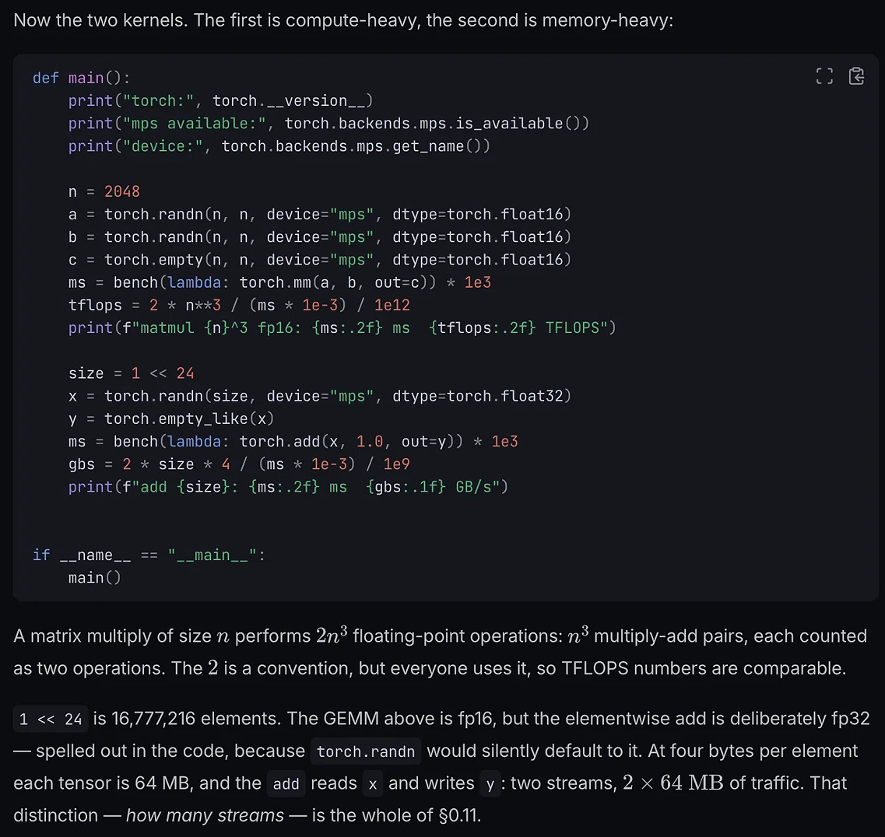

# Tensors and the 64 MB benchmark

> A DeepSeek transcript explaining tensors, PyTorch allocation size, and an element-wise addition benchmark on Apple MPS
>
> Source: [shared conversation](https://chat.deepseek.com/share/aa3sa1m6vcbxx3c221) on chat.deepseek.com, 2026-11-13. 2 questions, 2 answers. The source link expires when the conversation is deleted from DeepSeek.
> Recovered from the shared-conversation HTML export: original LaTeX math and attached screenshots preserved.

---

## User



What is a tensor, and why is it 64 MB in this example?

---

## DeepSeek

Here is a breakdown of what a tensor is and exactly how the math works out to 64MB for this specific example.

### 1. What is a Tensor?

In machine learning and PyTorch, a **tensor** is simply a multi-dimensional array of numbers. It is the fundamental data structure used to store and process data.

You can think of it as a generalization of basic math concepts:

- **0D Tensor (Scalar):** A single number (e.g., `5`)
- **1D Tensor (Vector):** A list of numbers (e.g., `[1, 2, 3]`)
- **2D Tensor (Matrix):** A grid of numbers (like the `n x n` matrices `a` and `b` in the code)
- **3D+ Tensor:** Higher-dimensional arrays (e.g., an image represented by height x width x color channels, or a batch of images).

Tensors in PyTorch are very similar to NumPy arrays, but they have a superpower: they can be moved to and processed by hardware accelerators like GPUs or Apple Silicon chips (which is what `device="mps"` does in your code).

---

### 2. Why is it 64MB?

The text explains this explicitly, but here is the step-by-step math based on the code:

#### 1. The number of elements

The code sets `size = 1 << 24`. This is a bitwise shift, which is a fast way of calculating $2^{24}$.

$2^{24} = 16,777,216$ elements.

#### 2. The size of each element

The code specifically sets `dtype=torch.float32`. This means every single number in this tensor is a **32-bit floating-point number**.

Because there are 8 bits in a byte, a 32-bit number takes up **4 bytes** of memory.

#### 3. The total memory calculation

To find the total size, multiply the number of elements by the size of each element:

$$
16{,}777{,}216 \text{ elements} \times 4 \text{ bytes/element}
= 67{,}108{,}864 \text{ bytes}
$$

#### 4. Converting to Megabytes (MB)

In computing, 1 Megabyte is typically calculated as $1024 \times 1024 = 1,048,576$ bytes.

$$
\frac{67{,}108{,}864}{1{,}048{,}576} = 64 \text{ MB}
$$

**Why the text cares about this:**\
The text is highlighting that the `add` operation reads tensor `x` (64MB) and writes to tensor `y` (64MB). This means it has to move $64 + 64 = 128$ MB of data through the memory bus just to do a simple addition. This is why it is used to benchmark **memory bandwidth (GB/s)** rather than compute power (TFLOPS).

---

## User

What is the add operation doing?

---

## DeepSeek

Based on the code in the image, here is exactly what the `add` operation is doing:

### The Operation Itself

The specific line of code is:

```python
ms = bench(lambda: torch.add(x, 1.0, out=y)) * 1e3
```

In plain English, this is doing an **element-wise addition**. It takes every single number inside tensor `x`, adds `1.0` to it, and puts the result into the exact same position in tensor `y`.

If `x` is an array of 16 million numbers, the operation looks like this mathematically:

- `y[0] = x[0] + 1.0`
- `y[1] = x[1] + 1.0`
- ...all the way to...
- `y[16,777,215] = x[16,777,215] + 1.0`

### Breaking Down the Code

- `x`: The input tensor (the 64MB array we just talked about).
- `1.0`: The scalar (a single number) being added to every element.
- `out=y`: This is a crucial instruction. It tells PyTorch, *"Do not create a brand new tensor to hold the answer. Just write the answer directly into the memory space we already set aside for `y`."* (Notice `y` was created right before this using `torch.empty_like(x)`).
- `bench(...)`: This is a custom function (not shown in the snippet) that runs this operation multiple times, measures how long it takes, and returns the average time.
- `* 1e3`: Converts the benchmark time from seconds to milliseconds (ms).

### Why is this called "Memory-Heavy"?

As the text in your image explains, the actual *math* here is incredibly simple. A modern GPU can perform billions of additions per second. However, the **data movement** is the bottleneck.

To perform this operation, the hardware has to:

1. **Read** 64MB from tensor `x` in memory.
2. **Write** 64MB to tensor `y` in memory.

That is **128MB of total memory traffic** just to do a simple `+1.0` to every number. The benchmark calculates the **GB/s (Gigabytes per second)** to see how fast the hardware can move that data back and forth, rather than how fast it can do math.

*(Note: If the code had just been `y = x + 1.0` without `out=y`, PyTorch would have had to pause and ask the operating system for a new 64MB chunk of memory every single time the benchmark ran, which would make the test wildly inaccurate! Using `out=y` measures pure memory speed.)*
